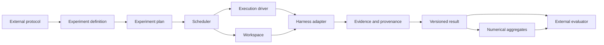
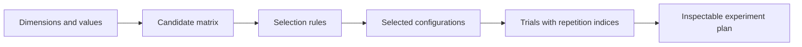
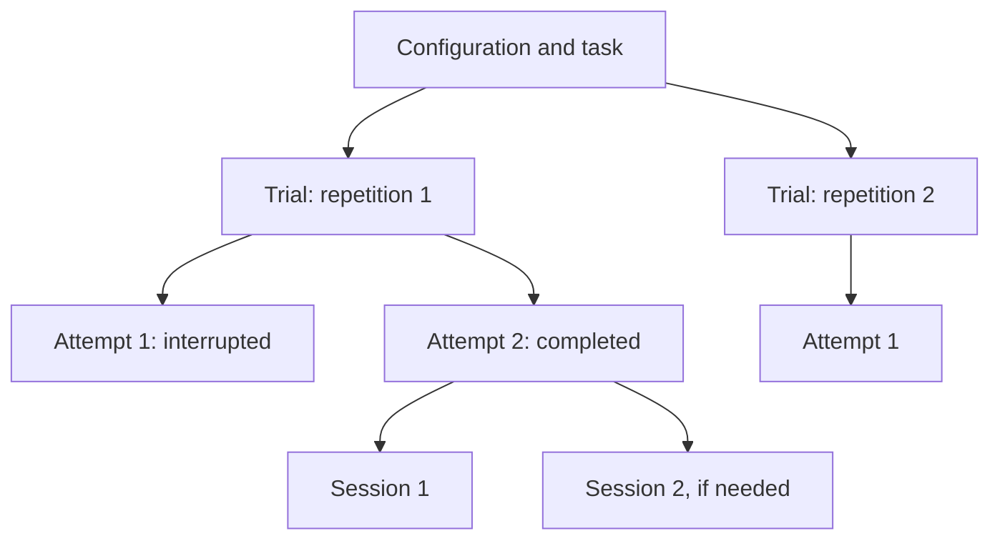
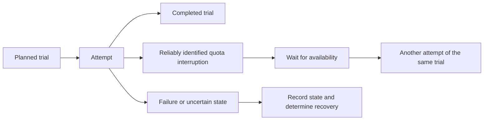
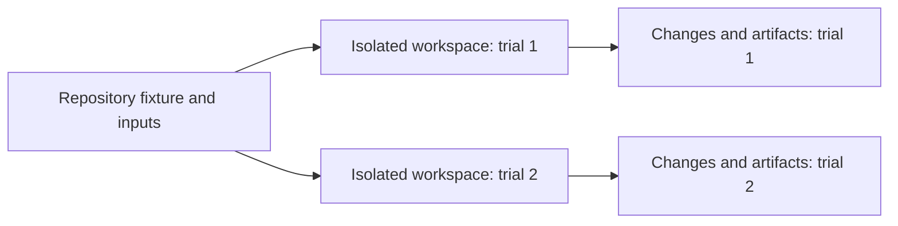
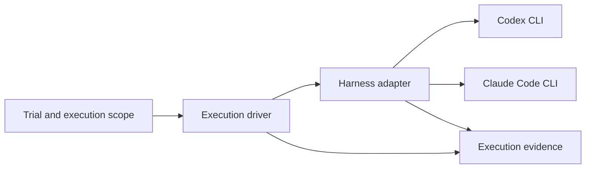
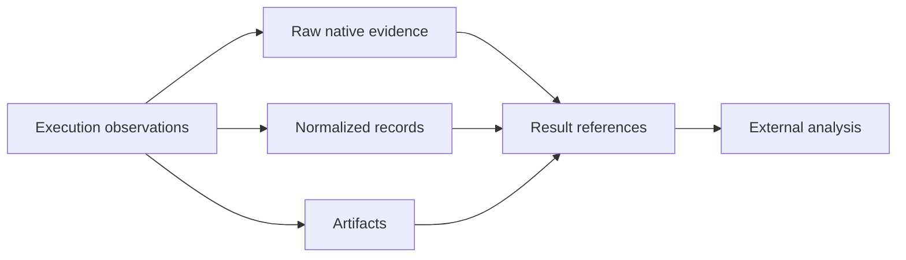
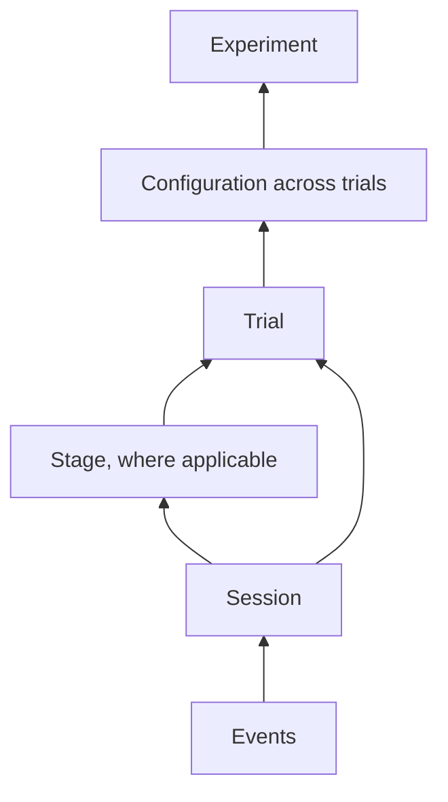

# wio-eval core concepts

This document describes the intended engine of wio-eval and the outcome each
of its components must provide. It is a basis for future Work contracts, not
an implementation plan or a claim that the engine exists today. The
[glossary](../GLOSSARY.md) defines the domain terms; the
[project overview](../README.md) describes the intended uses.

## 1. What the engine does

An external protocol chooses the question, experimental conditions and means
of evaluation. wio-eval turns an experiment definition into a plan, executes
its trials, and preserves what happened in a result. An external evaluator can
then interpret that evidence without rerunning the agents.

1. **Plan.** Expand and select matrix combinations, identify the resulting
   configurations and trials, and make the plan inspectable before execution.
2. **Execute.** Schedule trials under their specified conditions, prepare their
   workspaces, and invoke a harness through a bounded execution driver.
3. **Preserve.** Record attempts, provenance, observations and artifacts,
   retaining raw evidence alongside normalized records.
4. **Summarize.** Produce descriptive numerical aggregates without replacing
   the individual observations or deciding what they mean.
5. **Resume.** Recover unfinished work while retaining completed evidence and
   the distinction between independent trials and infrastructure retries.

These are responsibilities, not a prescribed package layout. Their boundaries
let future Works deliver pieces independently while preserving the system's
end-to-end outcome.

The external evaluator decides whether an outcome is good. wio-eval can report
that an execution completed, failed or remains incomplete, but those states are
not judgments of task success. It does not prescribe a statistical method,
judge, acceptance threshold or workflow policy.

## 2. From a definition to a plan

Suppose you want to compare two harnesses on the same task, three times each.
You supply an **experiment definition** with the task, the harnesses and the
number of repetitions. Before any agent starts, wio-eval produces a plan you can
inspect.

A **dimension** names a condition that can vary: harness, model, task,
instructions, workflow or repository fixture, for example. The **matrix**
forms candidate combinations of dimension values. Selection rules can keep
only the combinations the protocol wants to run. Each selected combination is
an **experiment configuration**, identified by its **matrix coordinates**.

A **scenario** describes a task and its relevant starting conditions. It is not
a repetition: running the same scenario three times produces three trials.
The plan identifies each trial, its configuration, repetition index and
execution conditions. A dry run shows this plan without starting an agent.

The plan keeps identities and coordinates stable across interruption and
resumption, so a result can be traced to what was planned. Dimensions are
extensible, and a protocol can choose an order, including randomized or
interleaved execution. The recorded plan and execution preserve enough
information to understand that order.

## 3. What counts as one observation

A **trial** is one intended independent execution of a configuration and task.
Its repetition index distinguishes it from the other trials of those same
conditions. If infrastructure interrupts the trial and it must be tried again,
the retry is another **attempt** of that trial, not a new independent trial.

A **session** is an agent interaction with a harness. A trial can contain more
than one session and, where a driver exposes them, workflow stages. The result
preserves these relationships and session identities and boundaries where
observable.

Every trial has an explicit beginning, execution scope and completion condition.
An interrupted or uncertain attempt remains visible; it is not silently
reported as a completed trial. This distinction also lets a later aggregate
count independent trials without counting retries as extra observations.

## 4. Scheduling and recovery

An experiment may run for days, encounter quota limits or be interrupted by a
process restart. The **scheduler** orders and starts planned work, manages
concurrency, and records attempts, interruptions and retries. The desired
outcome is that completed trials and their evidence survive, while unfinished
work can resume without silently duplicating successful trials.

A quota interruption is distinct from an agent failure. The scheduler pauses
affected execution and waits when subscription quota exhaustion is reliably
identifiable; it does not guess that an unrecognized failure is a quota event.
When recovery cannot be classified or performed safely, the result exposes the
uncertainty and incompleteness.

Execution supports existing authenticated CLI subscriptions without silently
switching to separately billed API authentication. Ordering, waits and retries
remain part of the record, including across restarts and quota windows.

## 5. Where a trial runs

A useful comparison needs a known starting point. A **repository fixture**
specifies a repository state and associated inputs; a **workspace** is the
filesystem environment in which a trial executes. With isolation, each trial
gets a fresh starting state. A shared workspace is also possible, but it is an
explicit, recorded non-isolated condition: mutable state can carry over between
trials.

The workspace preserves a controlled starting point and evidence of what
changed. Depending on what is available, that includes:

- The pinned source revision and prepared task and instruction inputs.
- A final working-tree state or recoverable artifacts, a diff and change
  information.
- Relevant environment details, including observable tools, permissions and
  configuration.

**Provenance** connects that evidence to the inputs and conditions that produced
it, including workflow identities or hashes and harness configuration.
Freezing a prompt alone does not establish reproducibility. Missing details,
observed differences and limits of observation remain visible. Temporary
workspaces can be cleaned up safely without losing preserved evidence.

## 6. How a trial runs

Two integration boundaries let the engine run different agents and different
kinds of execution:

- A **harness adapter** invokes a particular harness and captures its available
  native evidence and metadata through a common boundary.
- An **execution driver** defines how the trial's bounded execution proceeds.

Harness is a matrix dimension, so a protocol can compare agents on equivalent
starting conditions. Adapters preserve harness-specific behavior: the same
instruction files do not mean different harnesses load them identically. Adding
a harness should not require the common result model to privilege an existing
one or discard native evidence.

A standalone driver can run a task without wio. A wio integration can run a
selected locked workflow, bounded to one stage, one Work contract or a defined
sequence. It records the gate policy and observable stage boundaries. wio owns
workflow definitions, transitions and gates; wio-eval invokes the configured
driver and preserves what happened. Comparing workflows does not make wio a
mandatory dependency for other experiments.

## 7. What the engine preserves

An external evaluator may ask a question that was not anticipated when an
experiment ran. To make that possible, wio-eval preserves **evidence** in its
original form alongside a common view. Available evidence can include:

- Execution metadata, sessions, messages, outputs and errors.
- Model usage and observable tool and MCP activity, including available
  arguments, results, timing and relationships.
- Repository changes and other produced artifacts.

**Normalized records** give consumers a common view without destroying detail
needed for later analysis. A consumer can trace a record to its source and
distinguish directly observed values from inferred values and unavailable
information. Unsupported fields are not fabricated; cost estimates are
identified as estimates rather than measured usage. Arguments and results may
be redacted, and the resulting limits remain visible.

Evidence is associated with the appropriate experiment, trial, attempt,
session, stage or event. Partial evidence and capture failures remain visible
even when execution fails. Stable references to large artifacts let a consumer
retrieve them for offline analysis.

## 8. Results and numerical summaries

The **result** is the versioned machine-readable account an external system
receives. It brings the plan and inputs together with provenance, trials and
attempts, evidence references, artifacts, summaries, completeness and errors.
It preserves the identities and relationships needed to analyze a finished
experiment offline. Preserved evidence should be immutable, and references and
format versions should remain interpretable by future consumers.

An **aggregate** describes recorded observations at a stated scope and with a
stated denominator. For example, a consumer may want to see usage for one
session, total usage for a trial, or its distribution across repetitions of a
configuration. Summaries can also cover events, stages and the whole experiment.

The underlying observations remain available at each level. Aggregates can
describe usage, duration, tool and MCP activity, repository changes, retries,
quota waits and execution states when the evidence supports them. They do not
count attempts as independent trials, silently turn missing or inferred data
into measured totals, or judge whether activity was good.

## 9. What future Works need to settle

This document sets outcomes and boundaries; future Work contracts must turn
them into testable guarantees. They will need to settle, among other things:

- The result schema, artifact references and representation of missing or
  inferred observations.
- Identity, scheduling and safe resumption rules.
- Isolation mechanisms and provenance capture.
- Adapter and driver interfaces and their harness-specific capabilities.
- Reliable quota detection and recovery policies.

Those choices need to account for the capabilities and limits of each harness
and the existing Ataraxia runner. Mechanical validation of records and
completeness belongs in wio-eval. Semantic grading, statistical decisions,
instruction generation and workflow progression belong to external systems.
This document does not prescribe a file format, API or migration order.
