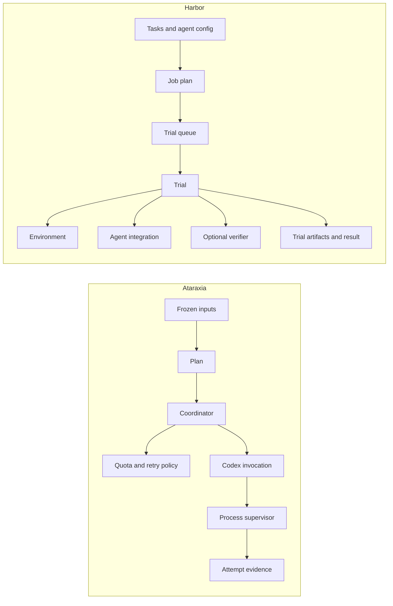

# Execution engine comparison

This report compares the existing
[Ataraxia evaluation runner](https://github.com/msitarz/ataraxia/tree/master/script/eval)
and [Harbor](https://github.com/harbor-framework/harbor) as starting points for
wio-eval. It describes capabilities and gaps relevant to wio-eval's intended
outcomes; it does not establish that either implementation satisfies every
requirement. [wio-eval's overview](../README.md) describes the target engine,
which is still a scaffold.

Ataraxia is a closer fit for the existing Codex subscription, quota and
attempt-evidence behavior. Harbor already supplies more of the multi-agent,
container and job machinery. The right choice depends on the cost of preserving
the required guarantees while adding what is missing; source inspection alone
does not establish which implementation is cheaper in person-hours.

## Purpose and scope

Ataraxia's runner freezes supplied inputs, expands a fixed matrix, runs Codex
and keeps evidence. Its
[documented boundary](https://github.com/msitarz/ataraxia/blob/master/script/eval/README.md#responsibilities)
leaves evaluation protocols and scoring to the caller. That is close to
wio-eval's execution-and-observability boundary.

[Harbor](https://github.com/harbor-framework/harbor) is a broader framework for
agent evaluation, benchmarks, environments and optimization. It includes
verification but can disable it, so its evaluation features do not prevent an
execution-only integration. Its terminology and result shapes still need
mapping to wio-eval's experiment, trial, attempt and session distinctions.
[Harbor job configuration](https://github.com/harbor-framework/harbor/blob/main/docs-mintlify/jobs/configs.mdx)

## Internal design

The two runners center their execution around different units. Ataraxia builds
on a quota-aware coordinator and durable attempt evidence. Harbor builds a job
of trials; each trial runs an agent and, optionally, a verifier in a pluggable
environment.

| Boundary | Ataraxia | Harbor |
| --- | --- | --- |
| Planning | Freezes inputs and expands context, model and effort combinations. | Builds trial configurations from tasks, agents and repetitions. |
| Scheduling | The coordinator tracks calls, attempts, retries and quota states. | A trial queue handles concurrency, per-agent limits, retries and backoff. |
| Agent | Consumer-owned ports separate binding, request building, invocation and classification; the implementation is Codex-specific. | `BaseAgent` defines agent setup and execution, with capabilities and concrete integrations. |
| Environment | The process supervisor launches Codex against an owned or caller-prepared local directory. | `BaseEnvironment` provides environment lifecycle, command execution and file transfer for local and remote implementations. |
| Evidence | An evidence store publishes the frozen plan, lifecycle events and raw per-attempt records. | Trial artifacts, logs and results are collected alongside supported trajectory exports. |
| Evaluation | The caller interprets evidence outside the runner. | A trial can run a verifier, which can be disabled. |

Ataraxia's
[runner ports](https://github.com/msitarz/ataraxia/blob/master/script/eval/runner/ports.py)
separate dispatch from adapters without yet defining a general multi-harness
contract. Harbor's
[agent base](https://github.com/harbor-framework/harbor/blob/main/src/harbor/agents/base.py)
and
[environment base](https://github.com/harbor-framework/harbor/blob/main/src/harbor/environments/base.py)
make the agent and its execution environment independent extension points.

### Settlement and recovery

Ataraxia's coordinator represents call and quota states explicitly. A retry adds
an attempt to a scheduled call; an evidence-write failure can leave settlement
pending rather than silently recording completion. The evidence writer publishes
new artifacts without replacement and synchronizes relevant writes. These
boundaries support preserving attempt evidence, but the current runner does not
resume a prior run after a process restart.
[Call states](https://github.com/msitarz/ataraxia/blob/master/script/eval/runner/coordinator/call_states.py),
[evidence writer](https://github.com/msitarz/ataraxia/blob/master/script/eval/evidence.py)

Harbor's queue creates a trial and uses its recorded exceptions to decide
whether to retry. A retry replays the trial, including earlier steps. Harbor's
job-level resume reconciles persisted trial results, but the retry and resume
cleanup paths described below can remove failed or partial trial evidence. Its
restart machinery and Ataraxia's attempt-evidence guarantees therefore address
different parts of wio-eval's recovery outcome.

## Capability comparison

| Outcome | Ataraxia runner | Harbor |
| --- | --- | --- |
| Harnesses | Codex CLI; runner ports provide some separation, but not a general multi-harness interface. | Multiple installed agent integrations and extension points. |
| Planning | Ordered Cartesian product of context directories, models and efforts; input freezing and dry run. | Expands tasks, agents and repetitions; supports job plans and concurrency. |
| Repetitions | No explicit independent-trial or repetition model. | Supports repeated trials; its `n_attempts` setting names repetitions, not wio-eval infrastructure attempts. |
| Workspace | Default owned empty workspace or caller-prepared directory, with explicit sandbox and tool requests. | Docker, Podman and remote environment integrations. |
| Attempt evidence | Per-attempt process records and raw stdout/stderr, plus frozen plans, lifecycle events and summary. | Trial artifacts and native logs where supported; retry and resume cleanup can remove partial evidence. |
| Subscription auth | Invokes Codex CLI subscription session; no direct provider API. | Codex auth-file and Claude OAuth options exist; effective authentication needs testing per configuration. |
| Quota | Optional Codex quota detection, waiting and probes; fail closed on unverified telemetry. | Classifies rate or usage-limit errors and supports bounded retry; reset-aware subscription queue management was not established. |
| Restart | No resume of a previous run after process restart. | Resumes jobs using persisted trial results, subject to cleanup behavior below. |
| Normalization | Raw Codex JSONL and operational records; no harness-neutral session schema. | ATIF trajectories and converters for some agents; completeness varies. |
| wio | No wio workflow driver. | No wio workflow driver identified in the reviewed source. |

The sources for these distinctions are Ataraxia's
[runner guide](https://github.com/msitarz/ataraxia/blob/master/script/eval/README.md),
[evidence writer](https://github.com/msitarz/ataraxia/blob/master/script/eval/evidence.py)
and
[quota adapter](https://github.com/msitarz/ataraxia/blob/master/script/eval/runner/adapters/codex_quota.py),
and Harbor's
[planner](https://github.com/harbor-framework/harbor/blob/main/src/harbor/job_plan.py),
[environment types](https://github.com/harbor-framework/harbor/blob/main/src/harbor/models/environment_type.py)
and
[installed-agent base](https://github.com/harbor-framework/harbor/blob/main/src/harbor/agents/installed/base.py).

## Workspace isolation

Ataraxia can borrow a caller-prepared directory and request Codex's
`workspace-write` sandbox with tools enabled. Writable execution requires
concurrency one. The runner does not clean or delete that directory, freeze its
contents or restore it between calls: calls and retries share the workspace.
Independent trials need independently prepared starting states. The default is
a harness-owned empty workspace with a read-only request. These are requested
controls, not proof of effective permissions, complete tool isolation or a
reproducible environment.
[Caller-prepared workspace](https://github.com/msitarz/ataraxia/blob/master/script/eval/README.md#caller-prepared-workspace)

Harbor can prepare container and remote environments for trials. Its existing
environment integrations are a promising way to avoid building those
mechanisms from scratch, but a fixture's exact starting revision, dirty state,
instruction variants, final diff and cleanup guarantees need focused validation
against wio-eval's intended contract. Neither an isolated container nor a
frozen prompt alone establishes complete reproducibility.

## Quota, retries and evidence

Ataraxia distinguishes scheduled calls from their infrastructure and capacity
attempts, retains per-attempt artifacts, and supervises processes. Optional
quota waiting uses Codex telemetry and separately accounted probes; it fails
closed when telemetry identity, freshness, completeness or scope cannot be
verified. Probes and retries have explicit controls, but the runner does not
provide a token or money budget. Waiting is part of the active run: after a
process restart, the caller must reconcile a new run rather than resume the old
one.
[Ataraxia runner guide](https://github.com/msitarz/ataraxia/blob/master/script/eval/README.md)

Harbor has error classification, retry and job resume. Its
[retry queue](https://github.com/harbor-framework/harbor/blob/main/src/harbor/trial/queue.py)
removes a trial directory before rerunning it; its
[resume path](https://github.com/harbor-framework/harbor/blob/main/src/harbor/job.py)
removes a trial directory without a result file. Those paths can discard failed
or partial evidence that wio-eval intends to retain. Disabling automatic retries
alone does not address resume cleanup. Harbor's ordinary backoff should not be
assumed to implement Ataraxia's subscription quota-reset coordination.

## Starting points and tradeoffs

### Extract and generalize Ataraxia

Ataraxia is a plausible lower-friction starting point for preserving existing
quota and evidence behavior because those behaviors are already its purpose.
Extraction also brings its tests and supporting process supervisor. It needs
import and package adaptation and dependencies including Pydantic and tiktoken;
it is not just a copy of one CLI file.

Substantial work remains: generalized dimensions and selected combinations,
independent repetitions, durable restart and resume, fresh trial workspaces,
repository capture, Claude and other harness adapters, versioned results and
normalized evidence. The existing runner's shared workspace and fixed matrix
must not be presented as those capabilities.

### Integrate Harbor

Harbor offers working building blocks for multiple agents, repetition,
container environments, concurrency, job resume and ATIF. A wio-eval driver
could potentially invoke Harbor with verification disabled and translate its
artifacts into a wio-eval result. A wio driver could be a separate integration;
Harbor does not need to own wio workflow decisions.

Before relying on Harbor as the execution backend, wio-eval would need to
address or work around the evidence-removing retry and resume paths, establish
subscription authentication and quota behavior, and verify that its planning,
workspace and artifact boundaries preserve the intended trial semantics. The
reviewed source does not establish these as impossible; it does not establish
them as solved either.

## Suggested comparison experiment

Use equivalent sanitized tasks and pinned starting conditions for a narrow
vertical slice in each runner. Check successful execution, an interrupted
attempt, infrastructure retry and process restart; inspect raw evidence,
workspace changes, trial identity and authentication behavior. For Harbor,
disable verification and automatic retries initially, and explicitly test the
resume cleanup path on disposable artifacts. For Ataraxia, supply a fresh
caller-prepared workspace and record that it is not automatically restored.

Use controlled fake harnesses first; a live subscription run is a separate
check of authentication and quota behavior. Compare the resulting work needed
to meet the same contract before deciding whether to extract, integrate or
combine the two. The outcome is a technical decision, not a claim that either
project already implements all of wio-eval.

## Controlled recovery comparison

A controlled probe exercised Ataraxia with a fake Codex process and Harbor's
actual retry queue and resume reconciliation with a simulated trial. Both used
an illustrative task to write a file. The probe focused on evidence retention
and recovery; it did not establish equivalent end-to-end execution in both
runners.

| Check | Ataraxia | Harbor |
| --- | --- | --- |
| Retry | A simulated, recognized capacity failure led to a successful second attempt. Both attempts' raw output and records remained under one call. A separate ambiguous failure was not retried. | A simulated infrastructure exception led the queue to replay the trial successfully. The first attempt's trial directory and its evidence were removed before replay. |
| Interruption | A `SIGTERM` sent during the fake process produced an incomplete run with a cancelled attempt. Its stdout, stderr and attempt record remained. | The probe created a partial trial directory to exercise resume cleanup; it did not interrupt a running Harbor process. |
| Restart | A new invocation using the same output directory was rejected, leaving the existing evidence intact. The runner did not resume that run. | Resume reconciliation removed the partial directory without a result. A separate completed trial directory remained and its result was recovered. |

These retry stimuli were different: Ataraxia received a recognized capacity
failure, while Harbor received an infrastructure exception. The fake Ataraxia
process wrote a workspace file before reporting capacity failure, so the probe
cannot establish realistic workspace restoration or the absence of effects from
that failure. The Harbor trial itself was simulated, even though its queue and
resume methods were real. Docker was unavailable, and the probe did not test
container lifecycle, subscription authentication or quota-reset waiting.

The observations sharpen the remaining integration question. A Harbor-based
engine would need to preserve attempt evidence before retry cleanup and partial
evidence before resume cleanup. Whether its hooks can do so reliably, including
when the process stops abruptly, remains to be tested. An Ataraxia-based engine
needs durable restart and reconciliation. The probe does not establish which
adaptation is less work; a common end-to-end slice with equivalent failure and
workspace conditions is still needed.
