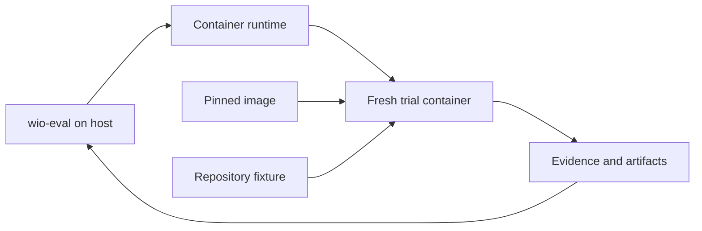

# Future scope

Ideas in this document are possible future extensions, not implemented
capabilities or commitments to a particular design. Future Work contracts must
settle their outcomes and constraints.

## Container-backed workspaces

A trial could run in a fresh container created from a pinned image. The image
could supply the harness, tools and dependencies; a repository fixture would
supply the starting state. This could make the environment more controlled and
limit the trial's access to the host. Filesystem workspaces would remain useful
for experiments that need them.

wio-eval could control Docker or Podman from the host through a CLI or runtime
API. The agent need not have access to the runtime's control socket. A dedicated
bind mount could make trial output available on the host, while a managed volume
could persist data for later export. A writable bind mount also lets the
container change its host directory, so its scope matters. Runtime control
socket access would give the agent powerful control over the runtime and could
undermine the intended isolation.

A future design needs to establish:

- **Authentication:** how each harness uses subscription credentials, including
  any keychain, refresh or interactive login requirements, without embedding
  secrets in an image or preserving them as evidence.
- **Isolation:** which host paths, network access, permissions and resources a
  trial receives, and what protection the selected runtime actually provides.
- **Provenance:** the image digest, runtime and configuration, mounts and other
  observable conditions needed to understand the execution.
- **Evidence and recovery:** how partial traces and workspace changes survive an
  interruption, how artifacts are exported, and whether a retry starts a fresh
  container while remaining an attempt of the same trial.
- **Portability:** how runtime, host and virtual-machine differences affect
  mounts, tools and reproducibility.

Containers can improve control over trial environments; they do not by
themselves guarantee security or reproduce external services and agent behavior.
The workspace outcome and the distinction between trials and attempts remain
as described in [core concepts](concepts.md).
