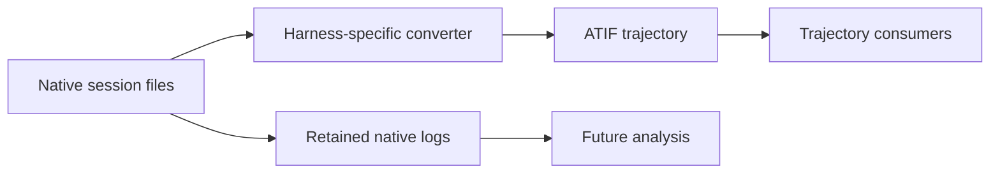

# Harbor normalization assessment

Harbor's agent converters and
[Agent Trajectory Interchange Format (ATIF)](https://github.com/harbor-framework/harbor/blob/main/docs-mintlify/agents/atif.mdx)
are useful starting points for a derived trajectory export. They do not by
themselves establish the source-linked and completeness-aware normalization
proposed for wio-eval. The distinction is between a useful common view of
agent activity and evidence that can be traced back to its native sources and
reinterpreted later.

This assessment considers Harbor's source and tests, with particular attention
to Claude Code and Codex. It does not establish conversion fidelity for every
harness or version. The
[existing projects report](normalization-existing-projects.md) compares ATIF
with other formats; the
[execution engine comparison](execution-engine-comparison.md) covers Harbor's
scheduling, recovery and evidence retention.

## What Harbor produces

For agents with ATIF support, Harbor can produce `agent/trajectory.json` from
agent activity. ATIF has a versioned trajectory structure with messages, tool
calls, observations, optional metrics and subagent trajectories. Its `extra`
fields allow additional metadata. Harbor's Claude Code and Codex integrations
convert native sessions after execution; their output and error handling are
adapter-specific. Other agents may implement their trajectories differently.
[ATIF models](https://github.com/harbor-framework/harbor/tree/main/src/harbor/models/trajectories),
[Claude Code adapter](https://github.com/harbor-framework/harbor/blob/main/src/harbor/agents/installed/claude_code.py),
[Codex adapter](https://github.com/harbor-framework/harbor/blob/main/src/harbor/agents/installed/codex.py)

The Claude Code integration places its session directory under agent logs, and
Codex copies its session files into agent logs. Thus Harbor can retain native
files alongside the derived trajectory. Capture and retention depend on the
integration and execution path: Harbor's retry and resume cleanup can remove
partial trial artifacts, as described in the
[execution engine comparison](execution-engine-comparison.md#quota-retries-and-evidence).

## Coverage and fidelity

Harbor's converters perform useful transformations, but an ATIF file's
validity does not establish that every native record was represented. The
following examples show why wio-eval needs raw evidence and explicit
transformation and coverage information:

| Area | Harbor behavior | Implication for wio-eval |
| --- | --- | --- |
| Unsupported input | Claude's converter skips malformed JSONL lines and records without a recognized message; it can also skip events that fail step conversion. Some diagnostics are logged at debug level. | Count and identify unrecognized or malformed records; mark a normalized result partial when appropriate. |
| Ordering | Claude session and subagent events are deduplicated by UUID and sorted by timestamp. | Preserve source order and relationships; a timestamp sort does not establish a definitive order across parallel sessions. |
| Event transformation | Codex selects a root session, handles copied child-session prefixes and synthesizes some web-search call identifiers. | Record source relationships and distinguish inferred identifiers from observed ones. |
| Usage and cost | Claude uses reported cost when available and can fall back to a LiteLLM estimate, marking that estimate. | Keep usage scope and source explicit and distinguish reported cost from an estimate. |
| Traceability | ATIF allows custom metadata, but its standard trajectory and step models do not define native artifact hashes, per-record source locations, converter ruleset versions or coverage diagnostics. | Preserve these links and diagnostics in wio-eval records; ATIF extensions could carry them when exporting. |

A converter can retain selected metadata in `extra` without retaining every
source field. Equally, ATIF's extensibility means that a missing standard field
does not make a provenance extension impossible. Fidelity must be assessed for
each adapter, source type and relevant harness version, rather than inferred
from the existence of a converter.

ATIF alone also does not define wio-eval's complete experiment plan, repository
and environment provenance, or trial and attempt lifecycle. The
[normalized session model](normalized-session-model.md) and
[adapter boundaries](normalization-adapters.md) describe those intended
wio-eval distinctions.

## Claude Code format changes and versioning

Harbor's Claude Code integration uses a shape-tolerant converter. It reads the
first available native event `version` as agent metadata, but the converter
does not select or validate a native session schema based on that value. The
ATIF schema version emitted by the converter identifies the *output* format;
it is not a Claude Code native schema version.

The converter accommodates known changes in one implementation. In particular,
it reads older inline sidechain events as well as newer separate subagent JSONL
files. Harbor's tests include examples of these layouts and UUID deduplication.
Unrecognized or changed records may still be skipped or partially converted
without an explicit unsupported-native-version diagnostic.
[Converter](https://github.com/harbor-framework/harbor/blob/main/src/harbor/agents/installed/claude_code.py),
[trajectory tests](https://github.com/harbor-framework/harbor/blob/main/tests/unit/agents/installed/test_claude_code_trajectory.py)

Harbor can install a requested Claude Code version. If none is requested, it
can reuse an existing installation or install without pinning a version.
Pinning controls which harness is run; it does not by itself prove that its
native session format is fully understood by the converter. A wio-eval adapter
needs to retain the observed harness version, its own ruleset version and the
compatibility outcome independently.

## Direction for wio-eval

Treat Harbor converters as candidates for reusable mapping logic and ATIF as a
potential interoperability export. Preserve raw native evidence independently,
link normalized observations to their sources, and report omissions, inferred
values and unsupported input. Do not assume that wrapping a converter supplies
those guarantees automatically.

A useful next assessment is a shared, sanitized fixture corpus for each
harness and relevant version. Compare each native record with converted output
and diagnostics, including malformed and unknown records, incomplete sessions,
usage, tool results, multiple sessions and subagents. That comparison can
inform whether to wrap a Harbor converter, adapt its mapping logic, or implement
a different normalizer. It should also test whether capture and retention
survive retries, interruption and restart.
