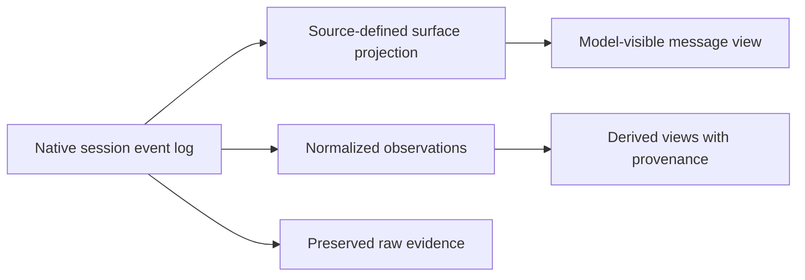

# Harness comparison: DeepSeek Harness

This comparison tests the [proposed session model](normalized-session-model.md)
against DeepSeek's own [DeepSeek Harness](https://www.deepseek.com/harness/en/),
an open-source, plugin-based agent harness in preview. It is distinct from
using a DeepSeek model through Codex, OpenCode or another harness. The latter
case uses that harness's adapter as well as a DeepSeek model configuration.
[DeepSeek's Codex integration](https://api-docs.deepseek.com/quick_start/agent_integrations/codex/)
illustrates that distinction.

This is a documentation and source review, not tested adapter support. No live
run was performed. Examples use synthetic values and `jsonc` comments; they are
excerpts, not complete wire records. The project describes its plugins and APIs
as evolving, so behavior must be checked against the actual version and profile.

## 1. Interfaces and session sources

The official launcher boots configurable profiles and plugins; the project
presents desktop and web interfaces. The launcher documentation illustrates a
headless profile invocation, but its availability and output contract depend on
the installed profile and plugins. Do not assume that an example profile is
present or that every deployment exposes the same stdout event stream.
[Launcher documentation](https://github.com/deepseek-ai/deepseek-harness/blob/master/apps/cli/README.md)

The
[session subsystem](https://github.com/deepseek-ai/deepseek-harness/blob/master/docs/subsystems/session.md)
describes an append-only, typed event log. Model-visible message history is a
projection of that log. Plugin-contributed event types can extend the log; some
events describe structural or internal activity rather than model-visible
messages. A normalizer should identify the harness, profile, plugins and source
interface where known, preserve unknown events and avoid treating every event as
a conversation message.



The documented JSON Lines persistence backend has versioned physical generations
and can use Zstandard compression. Its format documentation describes historical
codecs and migration, including differences in packed event representation. A
physical line, decoded logical event and source sequence number are therefore
not interchangeable for every version. Preserve the original artifact and record
format version, compression and the reader or migration used. Locators need to
address the original artifact and, where applicable, the decoded event within a
packed record.
[Persistence backend](https://github.com/deepseek-ai/deepseek-harness/blob/master/packages/session/session-persistence-jsonl/README.md),
[format migration](https://github.com/deepseek-ai/deepseek-harness/blob/master/packages/session/session-format-v3-to-v4/README.md)

## 2. Turns, steps and tool calls

The session documentation describes a native turn containing steps. A step is
one model call plus requested tool executions; a rejected or interrupted turn
may have no step. These names are native boundaries, not wio workflow stages or
wio-eval attempts. The common model needs typed relationships and source
identities rather than mapping a `step` by name to a stage.

A simplified native log event has this envelope:

```jsonc
{
  "type": "tool/call",
  "seq": 12,                         // Order within this native session log
  "time": 1767268800000,             // Unix epoch milliseconds
  "data": {
    "turn": 1,
    "step": 2,
    "callId": "call-1",
    "name": "example_tool",
    "arguments": "{\\"command\\":\\"pwd\\"}" // Raw model arguments
  }
}
```

The documented `callId` pairs a tool call with its `tool/result`. The result
can include a model-facing message and separate failure identity or tool-private
presentation metadata. Those surfaces must not be collapsed: an error reason
or display payload is not automatically content the model saw. Preserve raw
arguments even when a structured interpretation can be produced.
[Session event types](https://github.com/deepseek-ai/deepseek-harness/blob/master/docs/subsystems/session.md)

## 3. Model-visible history and recovery

DeepSeek's session source distinguishes message-producing surface events from
log-only events. Its surface operations can append or replace a span, for
example during compaction. A derived current model-visible view can therefore
omit or shadow historical events that remain in the log. The normalizer must
retain the source log and identify the projection rules and source events behind
any reconstructed view. It must not equate a human-facing transcript, current
model context and full execution evidence.

The session documentation also describes recovery and fork handling that can
produce synthetic turn-closing markers. Such a marker can be useful evidence of
a recovered or forked state, but it is not an event observed live at the
original interruption. Preserve its native origin and distinguish it from a
runner observation or an inference. A fork can inherit a prefix of a parent
session; copied history is not automatically new model activity or new usage.
The precise lineage and capture point need evidence.

## 4. Usage and incomplete execution

The session documentation describes an `assistant/message` for a completed
step with optional usage and an embedded provider stream. An
`assistant/attempt` can preserve a failed, retried or cancelled model attempt
that did not commit a surface message. Its documentation describes accounting
from embedded streams and a committed message's top-level usage as an authority
when present. These are source-specific rules; treating the stream and message
usage as independent additions would risk double counting.

```jsonc
{
  "type": "assistant/message",
  "seq": 20,
  "time": 1767268801000,
  "data": {
    "turn": 1,
    "step": 2,
    "message": { "role": "assistant", "content": [] },
    "stream": [],                    // Illustrative placeholder for native stream
    "interrupted": true              // Native marker of an interrupted prefix
  },
  "surfaceOp": "append"
}
```

This excerpt omits usage and other fields; it does not claim an empty stream or
message is representative of a real execution. An absent usage report is not
zero. The normalizer must preserve failed model attempts separately from a
wio-eval infrastructure attempt and retain usage even when no model-visible
assistant message was committed. Actual token category semantics, overlap,
provider-specific pricing and child inclusion need further verification.

## 5. Implications for the model

1. **Native, projected and synthetic origins:** distinguish a live observation,
   a retained native record, a source-synthesized recovery marker and a
   wio-eval-derived view. Preserve the evidence and rule behind each.
2. **Logical versus physical locators:** a compressed or historically packed
   session may require both a source-artifact location and a decoded event
   sequence. A derived locator must not masquerade as a byte offset in raw data.
3. **Execution versus model-visible content:** retain structural and plugin
   events as evidence without automatically placing them in conversation
   history; preserve surface replacement and lineage.
4. **Model attempts and accounting:** failed model attempts can carry usage
   without a committed message. Keep their evidence and avoid adding the same
   report again through an embedded stream or aggregate.

The existing session, provenance, usage and lifecycle concepts provide candidate
locations for these observations. The
[provenance proposal](normalization-provenance.md) is refined to distinguish
source-synthesized and projected records. Live captures, supported profile
identification and versioned fixtures are needed before an adapter contract or
compatibility claim.
