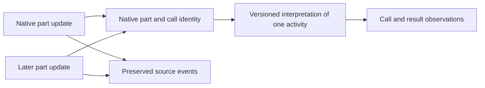

# Harness comparison: OpenCode

This comparison tests the [proposed session model](normalized-session-model.md)
against OpenCode's published CLI, API and source. It is a design review, not a
claim of adapter support. It does not include a live run or cover every release,
provider, server mode or source interface. Examples use synthetic values and
`jsonc` comments; they are excerpts, not complete wire records.

## 1. Sources and boundaries

OpenCode documents `opencode run` for non-interactive execution and a JSON
format for raw events. Its CLI also provides session export. The API exposes
session and event interfaces with their own shapes. These are separate sources;
a CLI stream, API event stream and exported session must not be assumed to have
identical coverage or schema.
[CLI reference](https://docs.dev.opencode.ai/docs/cli/),
[API reference](https://opencode.ai/docs/api)

OpenCode's source includes a
[v1 session schema](https://github.com/anomalyco/opencode/blob/dev/packages/schema/src/v1/session.ts)
and a separate
[v2 session contract](https://github.com/anomalyco/opencode/blob/dev/specs/v2/session.md).
These names show versioned upstream interfaces, but do not establish that all
CLI outputs or stored records carry a schema-version marker, or that their
compatibility follows one common policy. Record producer version, interface and
any verified schema version separately. A version-specific adapter needs
fixtures and source-specific rules rather than assuming one surface represents
all others.

## 2. Messages and evolving parts

The v1 session schema identifies messages and their parts, and defines part
updates, removals and deltas. A tool part carries a call ID and a state that can
be pending, running, completed or error. The following is an illustrative
excerpt of that source shape, not a complete event envelope:

```jsonc
{
  "type": "tool",
  "id": "part-1",                    // Native part identifier
  "messageID": "message-1",
  "sessionID": "session-1",
  "callID": "call-1",                // Native tool-call identifier
  "tool": "example_tool",
  "state": {
    "status": "running",              // State can later change
    "input": { "command": "pwd" }
  }
}
```

The
[v1 schema](https://github.com/anomalyco/opencode/blob/dev/packages/schema/src/v1/session.ts)
includes `message.part.updated`, `message.part.removed` and `message.part.delta`
events. Its shapes support identifying parts and calls, but the adapter must
verify how a particular source emits and orders updates before treating repeated
values as one activity. A removed or updated part is not evidence that the
earlier observation never existed.



The proposed model can represent call and result observations and cite multiple
sources, but needs an explicit way to preserve **updates to the same
observation**. A derived current view should cite its contributing updates and
rule, retain prior states, and identify incomplete or conflicting updates. It
must not count pending, running and completed views as three calls. A removal
or correction changes a view according to source semantics; it does not delete
the evidence from wio-eval's retained record.

## 3. Usage and completion

The v1 schema includes step-finish token and cost fields, and OpenCode's
[session processor](https://github.com/anomalyco/opencode/blob/dev/packages/opencode/src/session/processor.ts)
shows usage attached to a step-finish part and an assistant message. These can
be different representations of related activity. The source and version must
establish scope, category semantics and correlation before any reports are
combined or deduplicated. A native cost value requires its basis and currency to
be established before it is presented as a measured charge.

A reported issue describes JSON CLI output missing a final `step_finish` even
when session export contained the completed message. This is an issue report,
not proof that every version or run is affected. It illustrates why a clean
process exit, a stream's last event and an exported session should remain
separate evidence, and why missing usage cannot become zero.
[OpenCode issue #53207](https://github.com/anomalyco/opencode/issues/53207)

Similarly, an
[upstream issue](https://github.com/anomalyco/opencode/issues/29997) reports
that a CLI stream omitted the user's prompt while a session export contained it.
The runner can preserve the supplied task as its own input; it should not claim
the stream reported that message. Correlating the supplied input with a session
message requires evidence rather than text similarity alone.

## 4. Subagents and observability gaps

The current
[session schema](https://github.com/anomalyco/opencode/blob/dev/packages/schema/src/session.ts)
includes an optional `parentID` and fork information. These are useful native
relationships, but a parent session, a fork and a subagent are not automatically
the same thing. The normalizer must preserve the relationship type and source;
usage inclusion and completeness remain separate questions.

Tool state, message parts, provider metadata, permission decisions and session
errors can contribute evidence when exposed. The reviewed sources do not prove
that every file access, MCP call, subagent or model request is observable in
every interface. Raw records and diagnostics remain necessary for unknown
fields, missing updates and partial streams.

## 5. Implications for the model

1. **Updates and removals:** preserve source events and revision history while
   allowing a derived current view. Do not turn repeated part states into
   independent activity.
2. **Separate source interfaces:** a live stream and export may differ in
   coverage or arrive at different times. Correlate only with verified rules and
   report incomplete captures and conflicts.
3. **Typed relationships:** preserve parent, fork and subagent distinctions
   instead of flattening them into a generic parent link.
4. **Usage and completion:** preserve step and message reports, exit status and
   native completion evidence with their scopes. None alone proves task success
   or complete capture.

The existing model has candidate places for messages, tool activity, sessions
and usage. The update-history refinement is added to the model; its exact
encoding, identity rules and cross-version compatibility remain open. Live
captures and sanitized fixtures are needed before specifying an adapter.
