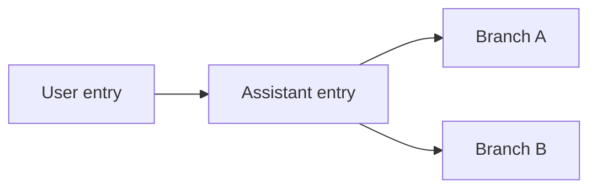

# Harness comparison: Pi

This comparison tests the [proposed session model](normalized-session-model.md)
against Pi coding agent's published documentation and source. It is a design
review, not a claim of adapter support. It does not include a live run or cover
all releases, providers and extensions. Examples use synthetic values and
`jsonc` comments; they are excerpts, not complete records.

## 1. Sources and versions

Pi documents JSON Lines session files and a separate JSON event stream. The
session file records entries and their relationships; JSON mode emits runtime
events. They are different source interfaces and may overlap. Preserve their
artifacts separately and correlate representations only under verified rules. A
runner must not assume a persisted session exists when persistence is disabled.
[Session format](https://github.com/earendil-works/pi/blob/main/packages/coding-agent/docs/session-format.md),
[JSON mode](https://github.com/earendil-works/pi/blob/main/packages/coding-agent/docs/json.md)

Unlike an unverified producer-version field, Pi documents a **session format
version** in its header. Its format documentation describes version 1 as a
legacy linear sequence, version 2 as a tree, and version 3 as a role rename.
It also describes automatic migration when older sessions are loaded. The
adapter needs to preserve the original bytes and format version before any
migration, and distinguish them from the CLI and adapter versions. Migration
behavior and compatibility of other interfaces require separate verification.

```jsonc
{
  "type": "session",
  "version": 3,                       // Native session format version
  "id": "session-1",                 // Session identity
  "timestamp": "2026-01-01T12:00:00Z",
  "cwd": "/workspace/project"
}
```

The session header's `id` identifies the session; the header is metadata and
is not itself an entry in the conversation tree. A `parentSession` path may
identify a source session for a fork or clone, but a path alone is not a
verified link to a retained artifact or a subagent relationship.

## 2. Branching conversation history

Pi session entries have native `id` and `parentId` links. Multiple children can
share a parent in the same file. File order describes the order of stored
entries; it does not by itself identify a single conversation path or show
which branch the model saw. Pi's documented context construction follows a
selected leaf to its ancestors and applies compaction and branch-summary rules.
[Session format and context](https://github.com/earendil-works/pi/blob/main/packages/coding-agent/docs/session-format.md)



These simplified entries illustrate the links, not a complete session:

```jsonc
{
  "type": "message",
  "id": "entry-a",
  "parentId": "entry-root",
  "timestamp": "2026-01-01T12:00:01Z",
  "message": { "role": "user", "content": "Try approach A." }
}
```

```jsonc
{
  "type": "message",
  "id": "entry-b",
  "parentId": "entry-root",          // A sibling, not the next step of A
  "timestamp": "2026-01-01T12:01:00Z",
  "message": { "role": "user", "content": "Try approach B." }
}
```

The normalized model needs native entry identities and typed parent edges in
addition to source order. A selected branch or model-visible context is a
separate, evidence-backed view, not a replacement for the full recorded tree.
If the selected leaf at a given point is unavailable, the adapter must not
choose one by guessing from the last line. Compaction and branch summaries may
change model-visible context without deleting the original evidence.

## 3. Runtime events and tools

Pi's
[JSON mode documentation](https://github.com/earendil-works/pi/blob/main/packages/coding-agent/docs/json.md)
describes `tool_execution_start`, `tool_execution_update` and
`tool_execution_end`, linked by `toolCallId`. An update is a partial result; the
documentation says whether it replaces or extends an earlier update depends on
the tool's result contract. The normalized model's tool observations and update
history can hold these without treating every update as a new call.

```jsonc
{
  "type": "tool_execution_update",
  "toolCallId": "call-1",           // Links updates to a native tool call
  "toolName": "example_tool",
  "args": { "command": "pwd" },
  "partialResult": {
    "content": [{ "type": "text", "text": "partial output" }],
    "details": {}
  }
}
```

A final event can carry a result, `isError` and `durationMs`. Pi describes that
duration as the tool's execution time measured with a monotonic clock, and
says it is absent when the tool did not run. Preserve that scope and source;
it is not necessarily the elapsed time between the first and last stream
records. Do not concatenate partial results or infer a final result without the
relevant contract and evidence.

Runtime message updates and final messages may be different views of the same
activity. Keep partial events and correlate them with finalized evidence only
when native identity and source-specific semantics support it. Stream
interruption can leave a partial tool or message without its final event.

## 4. Usage and cost

Pi's
[usage type](https://github.com/earendil-works/pi/blob/main/packages/ai/src/types.ts)
includes input, output, cache read and write, optional reasoning, total tokens
and cost fields. The source describes reasoning as included in output when
reported. It also distinguishes a provider-reported billed total from a catalog
estimate using `totalFromProvider`; this qualification belongs with the native
cost report and must not be silently converted into a subscription charge.

```jsonc
{
  "input": 100,
  "output": 40,
  "cacheRead": 20,
  "cacheWrite": 10,
  "reasoning": 5,                   // Reported subset of output, if present
  "totalTokens": 170,
  "cost": {
    "input": 0.001,
    "output": 0.002,
    "cacheRead": 0.0001,
    "cacheWrite": 0.0002,
    "total": 0.0033,
    "totalFromProvider": false       // Catalog estimate, not billed total
  }
}
```

The numbers illustrate a shape, not a pricing rule. The meaning of input and
cache categories for each provider and version still needs verification before
normalizing or summing. A session tree also raises a scope question: all
recorded branches, one selected path and one execution attempt are different
sets of activity. Usage on an abandoned branch remains evidence of work done,
but must not silently be attributed to the selected context path or counted
again when a fork copies history.

## 5. Implications for the model

1. **Entry graph and views:** preserve native entry parentage and source order;
   represent a selected branch or reconstructed context as an evidence-backed
   view. Preserve alternate branches.
2. **Version and migration:** retain the native session format version
   separately from producer and adapter versions, and keep pre-migration
   evidence.
3. **Tool partial results:** preserve updates and their native identities;
   append-versus-replacement semantics are tool-specific.
4. **Usage and cost:** preserve provider, branch and report scope, category
   semantics and cost basis. Copied or shared history is not automatically new
   usage.

These are design implications, not a completed mapping for every Pi event or
extension. Sanitized fixtures and live captures are needed to test branch
selection, version migration, cross-source correlation and completeness.
