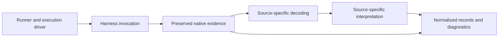

# Normalization adapters and versioning

This document proposes how adapters turn preserved native evidence into
versioned normalized records. It consolidates the
[session model](normalized-session-model.md),
[provenance proposal](normalization-provenance.md) and harness comparisons. It
is a design for review, not an implemented interface or a compatibility claim.
Examples use synthetic `jsonc`; field names and identifiers are proposals.

## 1. References to native evidence

A normalized record should let a consumer find the retained evidence that
supports it. A **source** identifies an artifact or captured stream and its
origin; a **locator** identifies the relevant portion. The artifact identity and
an integrity digest bind the reference to the retained bytes, not a mutable live
path. The examples omit unrelated fields:

```jsonc
{
  "id": "source-1",
  "artifact_id": "artifact-1",        // Stable reference within the result
  "media_type": "application/x-ndjson",
  "digest": { "algorithm": "sha256", "value": "example-digest" },
  "source_interface": "session_file"
}
```

```jsonc
{
  "source_id": "source-1",
  "locator": {
    "kind": "jsonl_line",
    "line": 7,                        // One-based line in preserved artifact
    "pointer": "/message/content/1"  // JSON Pointer within that line
  }
}
```

The digest is illustrative, not a valid hash. A record can cite multiple
sources, and one source record can support several observations. A pointer to
a content block does not automatically cite the surrounding role or timestamp;
field-level provenance or equivalent references must identify the evidence for
claims from different locations.

Locators depend on the artifact. A captured byte stream can use a byte range;
a JSON document can use a JSON Pointer; a JSON Lines record can use a line and
pointer. A compressed or packed artifact may need a logical event sequence and
a decoding rule in addition to a physical artifact reference. A decoded sequence
is not a physical byte offset. A source without a stable fine-grained locator
can be cited at artifact level with that limitation stated.

The preserved artifact is immutable for the purpose of its reference. If
redaction changes bytes, the retained redacted artifact gets its own identity
and digest, and the redaction and resulting limits are recorded. The model must
not leak withheld content through a locator or diagnostic. The exact digest,
locator variants and field-level encoding remain open for a Work contract.

## 2. Separate versions

A result needs enough version information to explain both the native evidence
and its interpretation. These are independent identities, even when a product
happens to use the same number for more than one:

| Identity | What it identifies |
| --- | --- |
| Normalized result format | The contract a consumer uses to read normalized records. |
| Adapter | The implementation and rules that interpreted the native evidence. |
| Harness producer | The harness build that produced an event or artifact, where known. |
| Source interface | The kind of source, such as a CLI stream, protocol or persisted session. |
| Native format or protocol | A source-specific format or protocol version, if established. |

```jsonc
{
  "normalized_format": { "name": "wio-eval-result", "version": "example" },
  "normalization": {
    "adapter": "example-harness",
    "adapter_version": "example-adapter-version",
    "ruleset": "example-ruleset"
  },
  "source": {
    "harness": "example-harness",
    "producer_version": "example-producer-version",
    "interface": "session_file",
    "native_format_version": "example-format-version"
  }
}
```

These placeholders do not prescribe version numbering or claim that every
source has a format marker. A missing version stays unknown. A CLI version is
not automatically a schema version, and the currently installed binary is not
proof of which version produced an older session. A file can contain mixed
producer versions; record version evidence at the scope supported by the source
rather than forcing one value for the whole artifact.

The normalized format needs a documented compatibility policy: consumers must
be able to identify its version and detect unsupported changes. Adapter changes
can improve interpretation without changing the native evidence or necessarily
changing the result format. Conversely, a result-format change is not evidence
that a harness changed. Exact numbering, evolution rules and migration policy
remain for a future contract; unknown versions must not be silently treated as
known-compatible.

## 3. Adapter boundaries

A harness adapter provides the integration for a harness. Its execution side
invokes the configured harness and exposes available native evidence; its
normalization side interprets that evidence. These responsibilities can share
code, but offline normalization must be possible from preserved evidence without
starting the harness again. Source-specific readers handle distinct interfaces
and verified version differences within that integration.



The runner owns the experiment plan, trial and attempt identities, process
lifecycle and workspace observations. The adapter owns harness-specific
invocation and interpretation of the harness sources it supports. An execution
driver defines bounded trial progression. Neither the adapter nor the
normalizer decides whether an agent's behavior was desirable.

Decoding reads the preserved representation, identifies its interface and
available version evidence, and yields native records or diagnostics. It must
preserve unknown data and distinguish physical locations from decoded logical
locations. Interpretation applies verified source-specific rules to produce
observations, relationships, usage reports and their evidence references.
Native identities and source origin remain available; source-synthesized events
must not be presented as directly observed live events.

A rule may join multiple native representations only when the relationship is
supported. It records the basis and retains each source reference. A missing
call, ambiguous match, conflict, partial message or unsupported field must not
be repaired by guessing. Adapters can produce partial results with explicit
diagnostics; the result must say what could and could not be interpreted.
Derived aggregates are separate from source decoding and retain their inputs,
scope and coverage.

An adapter should declare source interfaces and verified compatibility ranges
or capabilities, rather than requiring a wholly separate adapter for every
harness release. A release can introduce an incompatible change in one source
interface without changing another. Exact interfaces, dispatch rules and
compatibility-range representation remain open to future Work contracts.
