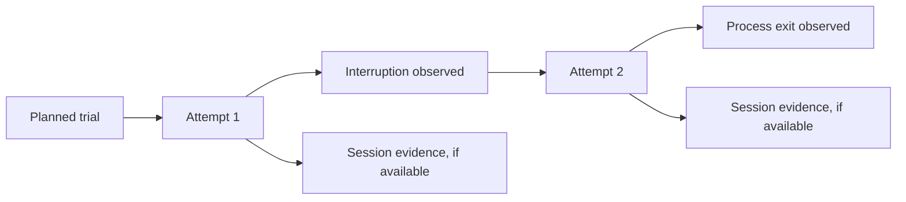
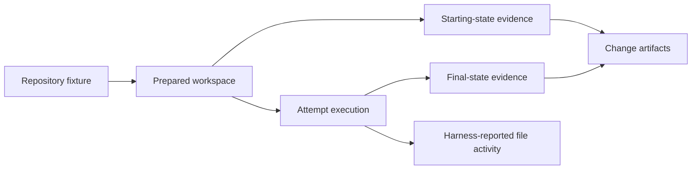

# Execution evidence for normalization

This working document extends the
[proposed session model](normalized-session-model.md) with evidence the runner
and workspace can supply. It describes intended outcomes, not implemented
records or a settled schema. The
[provenance proposal](normalization-provenance.md) applies to these observations
as well as to harness-native records.

Examples use synthetic `jsonc` excerpts. Comments explain fields; identities,
status names and storage layout are proposals. An omitted field is not
necessarily absent in the source.

## 1. Runner lifecycle

The runner knows what it planned to start and what it observed while managing
execution. Its lifecycle evidence connects the experiment plan to attempts and
sessions, including work that fails before a harness creates a session.



A trial is one intended independent observation. A retry is another attempt of
that trial, not another repetition. An attempt can contain several sessions or
none; a native session can be linked only when the relationship is supported by
runner or harness evidence. A stage is recorded where the execution driver can
identify its boundary; it is not assumed from a session or process boundary.

### Planned and observed execution

A plan record identifies the trial and intended conditions. It does not prove
that the runner started them. A runner event records an observed lifecycle
transition with a source and available time:

```jsonc
{
  "id": "event-1",
  "kind": "attempt_started",
  "trial_id": "trial-1",
  "attempt_id": "attempt-1",
  "timestamp": "2026-01-01T12:00:00Z",
  "observation_status": "observed", // Runner recorded the transition
  "evidence": [{ "source_id": "runner-log", "locator": {
    "kind": "jsonl_line", "line": 10
  }}]
}
```

The record is an illustrative normalized observation; it does not prescribe a
runner log format. The source and its locator identify preserved evidence.
Wall-clock timestamps, monotonic durations and their clock sources have
different properties and should be recorded when available. Missing end
boundaries remain unknown rather than being filled from the last event.

### Exit, failure and interruption

A process exit is an observation; the meaning of the exit is a separate claim.
For example, a zero exit status does not by itself establish that the task was
successful or that all evidence was captured.

```jsonc
{
  "kind": "process_exit",
  "attempt_id": "attempt-1",
  "data": { "exit_code": 1 },        // Directly observed process status
  "observation_status": "observed",
  "evidence": [{ "source_id": "runner-log", "locator": {
    "kind": "jsonl_line", "line": 25
  }}]
}
```

An interruption classification needs its own basis. A quota interruption can
be identified only when evidence reliably supports it. An unclassified failure
is not automatically an agent failure or a quota event. If a rule infers a
classification, the record should identify the rule and evidence, and retain
the direct observations. The attempt and trial can remain incomplete or
uncertain when recovery cannot safely determine their state.

```jsonc
{
  "kind": "interruption_classification",
  "attempt_id": "attempt-1",
  "data": { "classification": "quota_interruption" },
  "observation_status": "inferred", // Interpretation of separate evidence
  "rule": "example-quota-rule",
  "evidence": [{ "source_id": "stderr-artifact", "locator": {
    "kind": "byte_range", "start": 0, "end": 120
  }}]
}
```

The locator and rule are illustrative; the example does not assert that any
specific stderr text reliably identifies quota exhaustion. An unavailable or
redacted source limits what the classification can establish.

### Waits, retries and completion

A quota wait can have a start, end and reason where observable. A retry event
links the new attempt to the same trial and can state the runner's reason. If a
process stops or restarts before a wait ends, the missing boundary and recovery
state remain visible. Completion is a recorded state under an explicit execution
boundary; it is not a semantic judgment of the agent's answer.

The result should retain lifecycle events and their sources even for failed or
partial attempts. A summary can count attempts, interruptions and wait durations
only with defined scopes and denominators; overlapping or incomplete durations
must not be added as if they were independent complete waits.

### Questions for review: lifecycle

1. Which runner events establish attempt and trial completion, and how are
   uncertain process states resolved after a restart?
2. What source-specific evidence is sufficient to classify quota exhaustion and
   distinguish it from other interruptions?
3. How should a recovered session be linked across attempts without treating
   earlier events as new independent activity?
4. Which clock and interval semantics allow durations and waits to be compared
   without hiding missing boundaries?

## 2. Repository evidence

Repository evidence answers two different questions: what starting state was
prepared for a trial, and what state and changes were captured after execution.
A fixture expresses the intended starting conditions; workspace inspection
records what the runner actually observed. A harness's reported file activity
is another source, not a complete substitute for either.



### Starting state

A fixture can name a repository and pinned revision; the runner can inspect the
prepared workspace to record its actual revision and state. The two claims must
remain distinguishable: requesting a revision does not prove that preparation
succeeded, and a Git commit alone does not describe uncommitted or untracked
inputs.

```jsonc
{
  "kind": "repository_start",
  "trial_id": "trial-1",
  "workspace_id": "workspace-1",
  "data": {
    "fixture_id": "fixture-1",       // Intended input
    "requested_revision": "abc123",  // Illustrative shortened identifier
    "observed_revision": "abc123",   // Observed in the prepared workspace
    "working_tree_state": "clean"
  },
  "observation_status": "observed", // Applies to the workspace inspection
  "evidence": [{ "source_id": "workspace-inspection", "locator": {
    "kind": "jsonl_line", "line": 1
  }}]
}
```

The identifiers are illustrative, not a prescription for Git hash length. A
real record needs unambiguous revision and repository identity where available,
and separate provenance for the requested fixture and observed state. If
inspection fails, or a dirty starting tree is allowed, record the condition and
available artifacts without claiming a clean baseline. Instruction variants,
submodules, ignored files and other inputs may require separate evidence; a
revision alone does not establish their contents.

### Final state and changes

The runner can preserve a final Git diff, a working-tree status and other
artifacts needed to recover relevant changes. Their scope and collection time
matter: a diff against the starting revision, a staged diff and an unstaged diff
are different observations. A diff does not automatically include untracked or
ignored files. The result needs to say which files and states were captured,
omitted or unavailable, rather than imply that one artifact is complete.

```jsonc
{
  "kind": "repository_capture",
  "attempt_id": "attempt-1",
  "workspace_id": "workspace-1",
  "data": {
    "baseline": "starting-state-1",  // Reference to the compared state
    "diff_artifact": "artifact-diff-1",
    "untracked_artifact": "artifact-files-1",
    "capture_status": "partial"      // Some relevant state was not captured
  },
  "observation_status": "observed",
  "evidence": [{ "source_id": "workspace-inspection", "locator": {
    "kind": "jsonl_line", "line": 12
  }}]
}
```

A partial capture should identify the known omission or failure. A failed
attempt can still produce changes; capture them where possible before cleanup.
A shared workspace may include effects of other work, so its changes cannot
silently be attributed to one trial. An isolated workspace supports a stronger
boundary, but the isolation mechanism and its limits must be recorded.

### Reported activity and observed state

A harness can report a file read, edit or command. A final diff describes a
comparison of captured states. Neither proves the other: a file may be read
without changing it, modified and restored, or changed without a visible tool
record. Preserve both sources and any supported relationship, without inferring
a complete access history or attributing a change to a particular tool call by
proximity alone.

### Questions for review: repository

1. What fixture and workspace identities are sufficient to reproduce and
   compare the actual starting state, including dirty and non-Git inputs?
2. Which capture methods cover staged, unstaged, untracked, ignored and large
   files, and how are omissions or collection failures expressed?
3. How should attempt-level captures relate to trial-level output when a retry
   uses a fresh workspace or resumes a prior one?
4. How are shared-workspace effects and uncertain attribution represented?
