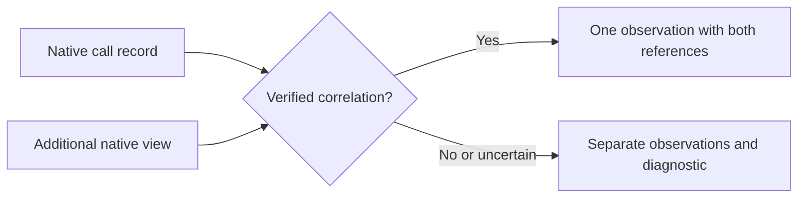

# Normalization provenance and diagnostics

This proposal works through three cases raised by the
[normalization walkthrough](normalization-walkthrough.md): one native record
producing several observations, several records describing one activity, and
evidence that cannot be fully interpreted. It refines the
[proposed session model](normalized-session-model.md); it is not yet a schema
contract or an implemented adapter specification.

Examples are synthetic `jsonc` excerpts. Comments explain fields, and omitted
fields are not necessarily absent. Line numbers and pointers refer to the
illustrative source shown in each case, not to local session files.

## 1. One record, several observations

A native message can contain multiple blocks. Consider a single JSON Lines
record at line 7:

```jsonc
{
  "type": "assistant",
  "message": {
    "role": "assistant",
    "content": [
      { "type": "text", "text": "I will check the directory." },
      { "type": "tool_use", "id": "call-1", "name": "Bash",
        "input": { "command": "pwd" } }
    ]
  }
}
```

The proposal is to emit a message observation and a tool-call observation. Each
cites the same source record but identifies the block that supports it. The
example uses [JSON Pointer](https://www.rfc-editor.org/rfc/rfc6901) for the
location within a JSON value:

```jsonc
{
  "id": "obs-message",
  "kind": "message",
  "data": {
    "role": "assistant",
    "content": [{ "kind": "text", "text": "I will check the directory." }]
  },
  "evidence": [{
    "source_id": "source-1",
    "locator": { "kind": "jsonl_line", "line": 7,
                 "pointer": "/message/content/0" }
  }]
}
```

```jsonc
{
  "id": "obs-call",
  "kind": "tool_call",
  "data": { "native_call_id": "call-1", "name": "Bash",
            "arguments": { "command": "pwd" } },
  "evidence": [{
    "source_id": "source-1",
    "locator": { "kind": "jsonl_line", "line": 7,
                 "pointer": "/message/content/1" }
  }]
}
```

The common envelope and session links are omitted for space. A pointer to a
block does not itself locate envelope fields such as role or timestamp. The
observation may also cite the enclosing record, or use field-level references
when a consumer needs to distinguish where individual values came from. The
exact encoding of those references remains open.

A line number and pointer are meaningful only relative to the **preserved source
artifact**, not an independently changing live file. A stable artifact identity
and an integrity check let consumers detect a mismatch. Other source kinds may
need different locators; a stream without a preserved record boundary cannot
promise a JSON Lines line number. If evidence was redacted before preservation,
the locator refers to the retained artifact and the limitation is reported.

## 2. Several records, one activity

A harness may emit a tool call and later provide a second, richer view of that
call. The two records can contribute to one normalized observation only if a
source-specific correlation rule establishes that they describe the same
activity. Similar names, text or timestamps alone are not sufficient.

Suppose an adapter has verified a native rule that links the two illustrative
records below by an identifier. The field `verified_link` is a placeholder for
that rule in this example, **not** a claim that Claude or Codex has a native
field by that name:

```jsonc
// Source record A: the call
{ "type": "call", "id": "native-1", "name": "example_tool" }
```

```jsonc
// Source record B: a later view, linked by a verified source-specific rule
{ "type": "completed_item", "verified_link": "native-1", "duration_ms": 1200 }
```

The resulting observation can cite both records and record the rule that
supports the correlation:

```jsonc
{
  "id": "obs-call",
  "kind": "tool_call",
  "data": { "native_call_id": "native-1", "name": "example_tool",
            "duration_ms": 1200 },
  "evidence": [
    { "source_id": "source-1", "locator": { "kind": "jsonl_line", "line": 4 } },
    { "source_id": "source-1", "locator": { "kind": "jsonl_line", "line": 9 } }
  ],
  "correlation": { "rule": "example-verified-rule" }
}
```

The `correlation` shape is illustrative. A consumer must be able to tell which
record supports the duration, rather than assume both sources reported it. A
future representation may use field-level provenance or an equivalent mapping.
If the records conflict, preserve both reported values and a diagnostic; do not
silently pick a winner. If the link is uncertain, retain separate observations
and report the ambiguity. A call and its result remain distinct linked
observations, even when their native IDs match: they describe different parts
of the interaction.



For Codex completed items and response items, the actual correlation rules need
to be established from source documentation and representative fixtures before
an adapter merges or deduplicates them. This example does not establish such a
rule. Counts and aggregates must not silently treat uncertain duplicates as
confirmed independent activity.

## 3. Unknown, missing, redacted or partially understood evidence

A missing value is not a negative result. For example, a tool result without
an error flag does not establish `is_error: false`. The model needs to make the
reason a value or observation is unavailable visible without inventing a value.
The exact vocabulary is still a design choice; these examples show the
distinctions the model needs to support:

| Situation | Meaning | Proposed treatment |
| --- | --- | --- |
| Observed | A source reports a value. | Preserve the value and its source. |
| Inferred | A rule derives a value from evidence. | Identify it as inferred and cite evidence and rule. |
| Not reported | The inspected source does not supply the value. | Do not substitute zero, false or an empty string. |
| Redacted | The value was deliberately withheld from retained evidence. | Mark the redaction and its scope without exposing the value. |
| Unreadable | Evidence is encrypted, malformed or otherwise inaccessible. | Report the reason when known and retain what can be preserved. |
| Unsupported | The adapter does not understand an event or field. | Preserve its raw reference and report the gap. |

These categories can apply at different levels. A source may omit a field, one
content block may be redacted, or a whole record may be malformed. A `null`
without an accompanying meaning is not enough to distinguish them. Not every
omitted field needs an individual diagnostic; the design needs a way for
consumers to tell what was actually checked and what remains unknown.

For an unknown event, the adapter can keep the artifact and add a diagnostic:

```jsonc
{
  "kind": "unsupported_native_event",
  "source": { "source_id": "source-1", "locator": {
    "kind": "jsonl_line", "line": 12
  }},
  "native_type": "example_new_event", // When safely readable
  "impact": "not_normalized"           // Do not imply a complete session
}
```

A malformed line may not have a readable type or JSON Pointer. In that case a
line or byte-range reference can identify the retained bytes, if the source
representation permits it. A partial final line, unavailable source and
redaction each need distinct diagnostics; none proves that the harness emitted
no other activity. Diagnostics themselves must not leak redacted content.

## 4. Proposed decisions and remaining questions

For review, this document proposes that:

1. A normalized observation cites a preserved source and a locator as precise as
   the source permits; JSON Lines sources can use a line plus JSON Pointer.
2. A verified, source-specific rule is required to combine multiple native
   representations into one observation. Uncertain links and conflicts remain
   visible.
3. Unknown or unreadable evidence and redactions have explicit diagnostics;
   missing values are never silently converted to negative or zero values.

The detailed encoding of field-level provenance, diagnostic severity and
completeness, stable IDs, artifact integrity, and locators for non-JSON sources
is still open. The adapter must also identify its version and the rule used so
that later normalization can be compared or repeated. The next case to work
through is usage: response, turn and session reports can overlap even when all
are valid observations.
