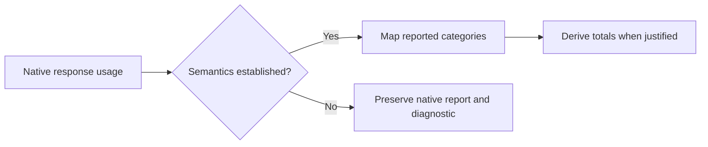

# Normalizing model usage

This working document examines how wio-eval could normalize usage without
conflating token categories or counting overlapping reports more than once. It
builds on the [session model](normalized-session-model.md) and
[provenance proposal](normalization-provenance.md). The examples are synthetic
`jsonc` excerpts, not complete native records or a settled schema.

The first scenario considers one model response. Later scenarios must address
multiple responses, cumulative totals, retries, subagents, incomplete reports
and cost. A response here means one model response, not a trial, attempt or
necessarily a whole agent turn.

## 1. One response: which tokens are included?

A normalized total is only useful if it means the same thing across sources.
The field name `input_tokens` alone is not enough: the documented Claude API
and OpenAI API use different input breakdowns.

### Claude API usage

The
[Claude prompt-caching documentation](https://platform.claude.com/docs/en/build-with-claude/prompt-caching)
describes three input categories for a request. Its total input is the sum of
uncached input, cache creation and cache reads. In this example, the derived
total input is 100 + 30 + 70 = 200 tokens.

```jsonc
{
  "input_tokens": 100,                 // Input outside the cache breakdown
  "cache_creation_input_tokens": 30,   // Input written to cache
  "cache_read_input_tokens": 70,       // Input read from cache
  "output_tokens": 40                  // Reported output tokens
}
```

The native `input_tokens` is therefore not, by itself, the total input for this
API usage shape. Cache creation can also have a breakdown by cache lifetime;
those details must not be added again to their parent category. The
[Claude Messages reference](https://platform.claude.com/docs/en/api/typescript/messages)
describes these fields and their total-input relationship.

### OpenAI API usage

The
[OpenAI usage documentation](https://developers.openai.com/api/docs/guides/agents-api/observability)
describes cached input as included in input tokens and reasoning output as
included in output tokens. In this example, total input is 200, not 200 + 70;
total output is 40, not 40 + 10.

```jsonc
{
  "input_tokens": 200,                  // Includes cached input
  "input_tokens_details": {
    "cached_tokens": 70                // Subset of input tokens
  },
  "output_tokens": 40,                 // Includes reasoning output
  "output_tokens_details": {
    "reasoning_tokens": 10             // Subset of output tokens
  },
  "total_tokens": 240                  // Reported input plus output
}
```

This is the documented API usage shape, not a claim that a Codex session file
contains this exact object. The inspected Codex records have their own fields,
including `input_tokens`, `cached_input_tokens`, `output_tokens` and
`reasoning_output_tokens`. Their source, scope and semantics must be established
before applying an API mapping to them. OpenAI's
[Codex usage notification schema](https://github.com/openai/codex/blob/main/codex-rs/app-server-protocol/schema/json/v2/ThreadTokenUsageUpdatedNotification.json)
shows a separate interface with a breakdown and last and total reports; it does
not by itself establish the semantics of every persisted session record.

### Proposed common view

For comparable, understood response-level reports, the common view can expose
total input and output alongside their available breakdowns. It retains the
native evidence and distinguishes a source-reported value from a calculated
one. This example maps the synthetic Claude report above; the `status` encoding
and rule identifier are proposals, not settled schema names.

```jsonc
{
  "scope": { "kind": "model_response", "native_id": "response-1" },
  "tokens": {
    "input_total": {
      "value": 200,
      "status": "derived",             // 100 + 30 + 70
      "rule": "claude-api-input-total"
    },
    "output_total": { "value": 40, "status": "reported" },
    "cache_read_input": { "value": 70, "status": "reported" },
    "cache_write_input": { "value": 30, "status": "reported" }
  },
  "evidence": [{ "source_id": "source-1", "locator": {
    "kind": "jsonl_line", "line": 7, "pointer": "/message/usage"
  }}]
}
```

The example's mapping is valid only if the adapter has established that the
native record uses the documented API semantics and represents the specified
response. A response ID or association must not be invented when absent. A
source-reported total could be marked `reported` instead; a derived value needs
its inputs, rule and adapter version traceable through provenance. The native
fields and breakdown remain available even when a common total is produced.



If a required component of a derived total is missing or its meaning is
uncertain, the adapter cannot substitute zero. It preserves what was reported
and leaves the total unavailable unless the relevant source contract explicitly
establishes the missing component's value. Similarly, a `thinking_tokens` or
reasoning field is not mapped to a common subset merely because its name looks
similar: the source must establish its meaning and inclusion relationship.

## 2. Questions for review

1. Should the common view use `input_total` and `output_total` for totals whose
   definitions are verified, while retaining native categories separately?
2. Should a calculated total use the label `derived` rather than `inferred`, or
   should both be represented under one provenance vocabulary?
3. What evidence establishes that a session's usage record describes one
   response, and how do we link it when a native response ID is absent?
4. Which source-specific contracts establish the semantics of Claude Code and
   Codex session fields, including reasoning and cache writes? API documentation
   alone does not establish that every harness record has identical semantics.
5. How should the result represent a reported total that disagrees with a
   defensible calculation from its components?

The next scenario examines several model responses within one turn, including
whether and when their reports can be summed.
