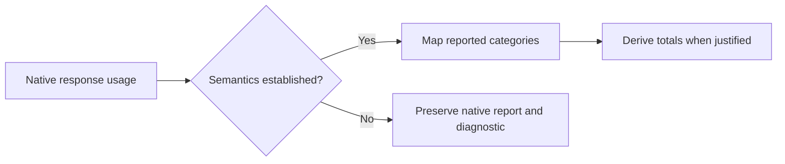
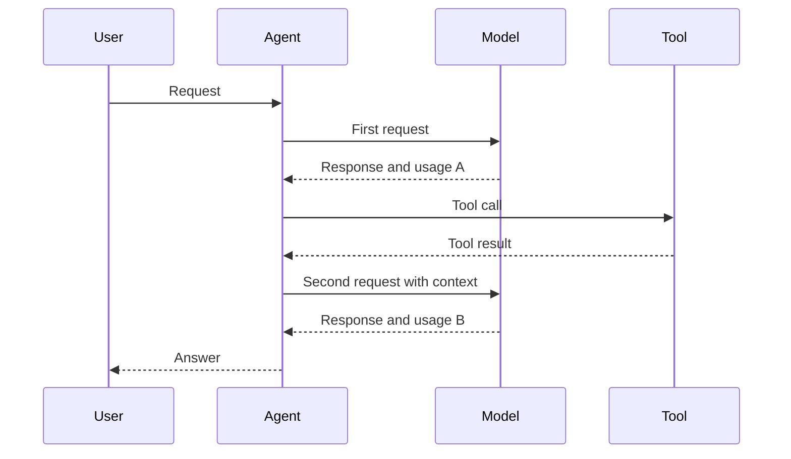
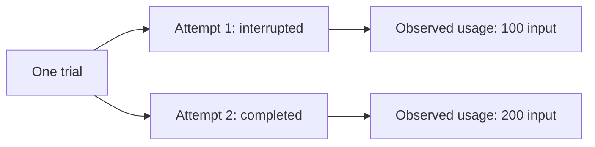

# Normalizing model usage

This working document examines how wio-eval could normalize usage without
conflating token categories or counting overlapping reports more than once. It
builds on the [session model](normalized-session-model.md) and
[provenance proposal](normalization-provenance.md). The examples are synthetic
`jsonc` excerpts, not complete native records or a settled schema.

The first scenario considers one model response. Later scenarios must address
multiple responses, cumulative totals, retries, subagents, incomplete reports
and cost. A response here means one model response, not a trial, attempt or
necessarily a whole agent turn.

## 1. One response: which tokens are included?

A normalized total is only useful if it means the same thing across sources.
The field name `input_tokens` alone is not enough: the documented Claude API
and OpenAI API use different input breakdowns.

### Claude API usage

The
[Claude prompt-caching documentation](https://platform.claude.com/docs/en/build-with-claude/prompt-caching)
describes three input categories for a request. Its total input is the sum of
uncached input, cache creation and cache reads. In this example, the derived
total input is 100 + 30 + 70 = 200 tokens.

```jsonc
{
  "input_tokens": 100,                 // Input outside the cache breakdown
  "cache_creation_input_tokens": 30,   // Input written to cache
  "cache_read_input_tokens": 70,       // Input read from cache
  "output_tokens": 40                  // Reported output tokens
}
```

The native `input_tokens` is therefore not, by itself, the total input for this
API usage shape. Cache creation can also have a breakdown by cache lifetime;
those details must not be added again to their parent category. The
[Claude Messages reference](https://platform.claude.com/docs/en/api/typescript/messages)
describes these fields and their total-input relationship.

### OpenAI API usage

The
[OpenAI usage documentation](https://developers.openai.com/api/docs/guides/agents-api/observability)
describes cached input as included in input tokens and reasoning output as
included in output tokens. In this example, total input is 200, not 200 + 70;
total output is 40, not 40 + 10.

```jsonc
{
  "input_tokens": 200,                  // Includes cached input
  "input_tokens_details": {
    "cached_tokens": 70                // Subset of input tokens
  },
  "output_tokens": 40,                 // Includes reasoning output
  "output_tokens_details": {
    "reasoning_tokens": 10             // Subset of output tokens
  },
  "total_tokens": 240                  // Reported input plus output
}
```

This is the documented API usage shape, not a claim that a Codex session file
contains this exact object. The inspected Codex records have their own fields,
including `input_tokens`, `cached_input_tokens`, `output_tokens` and
`reasoning_output_tokens`. Their source, scope and semantics must be established
before applying an API mapping to them. OpenAI's
[Codex usage notification schema](https://github.com/openai/codex/blob/main/codex-rs/app-server-protocol/schema/json/v2/ThreadTokenUsageUpdatedNotification.json)
shows a separate interface with a breakdown and last and total reports; it does
not by itself establish the semantics of every persisted session record.

### Proposed common view

For comparable, understood response-level reports, the common view can expose
total input and output alongside their available breakdowns. It retains the
native evidence and distinguishes a source-reported value from a calculated
one. This example maps the synthetic Claude report above; the `status` encoding
and rule identifier are proposals, not settled schema names.

```jsonc
{
  "scope": { "kind": "model_response", "native_id": "response-1" },
  "tokens": {
    "input_total": {
      "value": 200,
      "status": "derived",             // 100 + 30 + 70
      "rule": "claude-api-input-total"
    },
    "output_total": { "value": 40, "status": "reported" },
    "cache_read_input": { "value": 70, "status": "reported" },
    "cache_write_input": { "value": 30, "status": "reported" }
  },
  "evidence": [{ "source_id": "source-1", "locator": {
    "kind": "jsonl_line", "line": 7, "pointer": "/message/usage"
  }}]
}
```

The example's mapping is valid only if the adapter has established that the
native record uses the documented API semantics and represents the specified
response. A response ID or association must not be invented when absent. A
source-reported total could be marked `reported` instead; a derived value needs
its inputs, rule and adapter version traceable through provenance. The native
fields and breakdown remain available even when a common total is produced.



If a required component of a derived total is missing or its meaning is
uncertain, the adapter cannot substitute zero. It preserves what was reported
and leaves the total unavailable unless the relevant source contract explicitly
establishes the missing component's value. Similarly, a `thinking_tokens` or
reasoning field is not mapped to a common subset merely because its name looks
similar: the source must establish its meaning and inclusion relationship.

### Questions for review: one response

1. Should the common view use `input_total` and `output_total` for totals whose
   definitions are verified, while retaining native categories separately?
2. Should a calculated total use the label `derived` rather than `inferred`, or
   should both be represented under one provenance vocabulary?
3. What evidence establishes that a session's usage record describes one
   response, and how do we link it when a native response ID is absent?
4. Which source-specific contracts establish the semantics of Claude Code and
   Codex session fields, including reasoning and cache writes? API documentation
   alone does not establish that every harness record has identical semantics.
5. How should the result represent a reported total that disagrees with a
   defensible calculation from its components?

## 2. Several responses in one turn

An agent can call a model, run a tool, and call the model again before the turn
ends. Each model call may reuse earlier context. That repeated input is still
usage of each call; it is not deduplicated merely because the text is similar.
The question is whether the **usage reports** describe distinct calls or
repeated views of the same usage.



### A native example: Codex usage records

The inspected Codex files contain `token_usage_record` entries with response,
turn and thread fields. Current
[Codex session source](https://github.com/openai/codex/blob/main/codex-rs/core/src/state/session.rs)
constructs a record from a response's usage and adds it to running turn and
thread counters. This is evidence about that implementation, not a promise for
all versions, histories or execution modes. The following records are synthetic
excerpts illustrating that behavior; other fields are omitted.

```jsonc
{
  "type": "token_usage_record",
  "payload": {
    "turn_id": "turn-1",
    "response_id": "response-a",
    "usage": { "input_tokens": 100, "output_tokens": 20 }, // Response A
    "turn_token_usage": { "input_tokens": 100, "output_tokens": 20 }
  }
}
```

```jsonc
{
  "type": "token_usage_record",
  "payload": {
    "turn_id": "turn-1",
    "response_id": "response-b",
    "usage": { "input_tokens": 150, "output_tokens": 30 }, // Response B
    "turn_token_usage": { "input_tokens": 250, "output_tokens": 50 }
  }
}
```

Under the illustrated semantics, response A plus response B gives 250 input and
50 output tokens for the observed reports. The second `turn_token_usage` is an
overlapping running total. Adding it to the two response reports, or adding
both turn snapshots together, would count usage more than once. The matching
numbers are useful for reconciliation; they do not alone prove that all calls
in the turn were captured.

### Proposed normalized reports

Keep each response report and the native turn snapshot as distinct usage
observations. Their identities, scope, source locators and interpretation remain
visible. These excerpts use the proposed vocabulary from the first scenario;
evidence locators and token fields are shortened for readability.

```jsonc
{
  "id": "usage-a",
  "scope": { "kind": "model_response", "native_id": "response-a" },
  "turn": "turn-1",                   // Link only when supported by source
  "report_kind": "response_usage",
  "tokens": { "input_total": 100, "output_total": 20 }
}
```

```jsonc
{
  "id": "usage-b",
  "scope": { "kind": "model_response", "native_id": "response-b" },
  "turn": "turn-1",
  "report_kind": "response_usage",
  "tokens": { "input_total": 150, "output_total": 30 }
}
```

```jsonc
{
  "id": "turn-snapshot-2",
  "scope": { "kind": "turn", "native_id": "turn-1" },
  "report_kind": "cumulative_snapshot", // Overlaps the response reports
  "tokens": { "input_total": 250, "output_total": 50 }
}
```

Each normalized report needs its own source references and category semantics,
including whether the common totals are reported or derived as described in
the first scenario. A record containing several reports can support several
observations; their locators should identify the relevant fields. A native
response identifier is used only where the source actually provides one.

### When a turn sum is defensible

A derived turn sum can add distinct response observations only when the adapter
or aggregation policy can establish all of these:

1. Each report has compatible, understood token semantics and belongs to the
   turn being summarized.
2. Each report covers a distinct model response; repeated reports or partial
   updates for one response are not treated as additional calls.
3. The set of reports is known to cover the intended scope, or the result is
   explicitly identified as a partial sum of observed responses.
4. Any included retries or other calls match the stated scope; an omitted or
   unknown call is not silently assumed to have zero usage.

A partial sum describes what was observed, not the complete turn total. Its
record should identify its contributing reports, aggregation rule and coverage.
An illustrative partial sum might look like this:

```jsonc
{
  "scope": { "kind": "turn", "native_id": "turn-1" },
  "measure": "input_total",
  "value": 250,
  "status": "derived",
  "coverage": "partial_or_unknown",    // Not a claim of complete turn usage
  "contributions": ["usage-a", "usage-b"],
  "rule": "sum_distinct_response_usage"
}
```

The exact labels and representation remain open. A reported turn snapshot and a
derived sum can be compared when their scopes and definitions are compatible;
they are not added together. If they disagree, keep both and report the
difference and uncertainty. Do not silently choose a winner. A snapshot is not
necessarily final merely because it is the last one retained in an incomplete
source.

### Questions for review: several responses

1. What source-specific evidence establishes that a usage report is final for a
   response and that all relevant responses in a turn have been captured?
2. How should a consumer distinguish a known partial sum from a sum whose
   coverage cannot be established at all?
3. Which native IDs and version-specific rules can safely identify repeated
   reports for the same response, including across different source interfaces?
4. How should disagreements between a reported snapshot and a calculated sum
   be represented without implying that either is authoritative?

The next scenario examines cumulative turn and session totals over time,
including repeated snapshots and what can be concluded from an interrupted
stream.

## 3. Turn and session snapshots over time

A source can report a running total more than once. Consider two turns, with
input counts only for clarity:

| Report | Scope | Input tokens | Interpretation in this example |
| --- | --- | ---: | --- |
| A | Turn 1, first snapshot | 100 | Running turn total |
| B | Turn 1, later snapshot | 250 | Includes A |
| C | Session, after turn 1 | 250 | Includes turn 1 |
| D | Turn 2, final report | 80 | Separate turn |
| E | Session, after turn 2 | 330 | Includes C and turn 2 |

These are synthetic reports under an assumed cumulative-counter contract. Adding
A, B, C, D and E yields a meaningless total. When source semantics and ordering
establish that E is the final session snapshot, it reports 330 input tokens;
B and D may independently support a derived sum of 330 if their scopes are
complete and non-overlapping. They are alternative accounts of the same usage,
not extra contributions to E.

```jsonc
{
  "scope": { "kind": "session", "native_id": "session-1" },
  "report_kind": "cumulative_snapshot",
  "sequence": 5,                     // Order within this source
  "tokens": { "input_total": 330 },
  "finality": "unknown",             // Last observed is not necessarily final
  "evidence": [{ "source_id": "source-1", "locator": {
    "kind": "jsonl_line", "line": 20
  }}]
}
```

The source contract must establish what the counter covers, when it resets and
whether a later snapshot supersedes an earlier one. A turn-ending event alone
does not prove that all delayed accounting has arrived. A session may resume,
a stream may end early, and a harness may report revised values. Preserve
snapshots, their ordering and any finality evidence. Do not derive deltas by
subtraction across a reset, an unknown boundary or incompatible definitions.
If counters decrease or disagree unexpectedly, retain the reports and surface a
diagnostic rather than forcing monotonicity.

A summary should name its basis: a reported snapshot, or a sum of distinct
reports with their contributors and coverage. Reconciliation can compare
compatible bases, but matching numbers do not prove completeness. When the
source is interrupted, the last observed snapshot is a snapshot through an
unknown point, not a final session total by default.

### Questions for review: snapshots

1. Which source-specific events establish finality, and can usage arrive after
   them or change on resume?
2. How should counter resets, corrections and incompatible snapshots be
   represented without losing their history?
3. What coverage and scope evidence is sufficient for comparing a reported
   total with a sum of turn reports?

## 4. Retries and interruptions

A trial can have more than one attempt. An interrupted attempt may already have
consumed tokens; a later infrastructure retry does not erase that usage or
become another independent trial. Model-level retries within an attempt are also
possible, but are a separate boundary from a wio-eval attempt.



In this synthetic example, a trial-level resource summary may report 300 input
tokens **only if** both observations have compatible semantics, represent
non-overlapping calls and cover the intended attempt scope. If the interrupted
attempt has an incomplete usage stream, 300 is at most the sum of the observed
reports; it is not a verified complete trial total. The record retains both
attempts and their individual coverage.

```jsonc
{
  "scope": { "kind": "trial", "id": "trial-1" },
  "measure": "input_total",
  "value": 300,
  "status": "derived",
  "coverage": "unknown",            // Interrupted attempt may have more usage
  "contributions": ["attempt-1-usage", "attempt-2-usage"]
}
```

The runner owns attempt identity and records interruption and retry evidence.
The adapter reports model usage and any native retry evidence it can observe.
A failed call without a usage report has unknown usage, not zero; the engine
must not manufacture a model-call record merely from a process retry. A later
scenario must decide how trial-level summaries account for partial attempts
across repetitions without losing denominators.

### Questions for review: retries

1. When can the runner establish that a recovered session belongs to the same
   attempt or to a new attempt without duplicating earlier usage?
2. Which harnesses expose model-call retries and their usage, and which only
   report a combined or incomplete total?
3. How should a trial summary show known usage alongside unknown consumption
   from interrupted attempts?

## 5. Subagents and parallel sessions

An agent can delegate work to a child session while the parent continues. A
parent usage report might cover only the parent, or it might include children;
the relationship depends on the source's documented semantics. Concurrent
activity does not make their usage independent if one report already includes
another.

Suppose the parent reports 500 input tokens and a child reports 200:

- If the parent report is known to exclude the child, both reports are complete
  and their scopes do not overlap, their combined input is 700.
- If the parent report is known to include that child, adding 200 again would
  double count. The parent report is 500 for its stated inclusive scope.
- If inclusion is unknown, both reports remain available, but neither 500 nor
  700 is established as a complete combined total.

```jsonc
{
  "scope": { "kind": "session", "id": "parent-session" },
  "measure": "input_total",
  "value": 500,
  "child_coverage": "unknown",      // Proposed label, not a native field
  "evidence": [{ "source_id": "source-1", "locator": {
    "kind": "jsonl_line", "line": 20
  }}]
}
```

Record observed parent-child relationships and their sources independently of
usage. A known relationship does not establish usage inclusion. Missing child
sessions, unknown relationships, parent snapshots and multiple source views can
all affect coverage. A summary across parallel sessions needs compatible scopes,
deduplicated observations and evidence of inclusion or exclusion before adding
values. It must not infer non-overlap from different session IDs alone.

### Questions for review: subagents

1. For each supported source and version, do parent reports include child
   usage, and do child reports include their own descendants?
2. How can the runner and adapter identify missing child evidence and trace
   relationship changes during delegation or resumption?
3. How should a consumer request parent-only, inclusive-tree or observed-only
   usage when the source cannot establish all three?

## 6. Missing, partial and conflicting reports

Usage can be absent because a harness did not expose it, capture was
interrupted, a record was malformed or a value was redacted. These cases do not
mean the same thing. A reported zero is an observation; a missing count is not.
The [provenance proposal](normalization-provenance.md) describes the broader
distinctions, which usage records must carry through to aggregates.

Suppose a source reports 100 input tokens but no output count. The output is
unknown; the combined input-plus-output total cannot be calculated as 100. A
sum across ten trials with output reports for seven can describe those seven
observations and its denominator, but must not present their mean as the mean
of all ten trials. Whether the missing three were systematically different is
outside what the recorded numbers establish.

```jsonc
{
  "scope": { "kind": "configuration", "id": "config-1" },
  "measure": "output_total",
  "statistic": "mean",
  "value": 42,
  "denominator": 7,                  // Trials with usable observations
  "planned_trials": 10,
  "coverage": "partial",            // Three planned trials lack a usable value
  "contributions": ["trial-1-output", "trial-2-output"]
  // Illustrative excerpt: the other five contribution IDs are omitted.
}
```

A diagnostic should identify the affected scope, source and reason where known,
without exposing redacted data. Unsupported or unparsable records remain
available as raw evidence. The adapter should distinguish a known missing
report from uncertainty about whether the source was complete.

If two reports claim the same scope and category but disagree, preserve both,
their provenance and the conflict. They may reflect different accounting times,
revisions, semantics or capture errors; equality of names does not settle which.
A later source-specific rule may reconcile them when supported by evidence. An
aggregate must state which eligible reports it used and why, or leave the
measure unresolved if it cannot choose safely.

### Questions for review: incomplete data

1. Which availability and diagnostic states should be queryable for every
   measure, and how are redaction and unknown completeness represented?
2. Should aggregates include counts of planned, completed and usable trials
   separately, and what should happen when their denominator is zero?
3. How are reported revisions distinguished from genuinely conflicting values?
