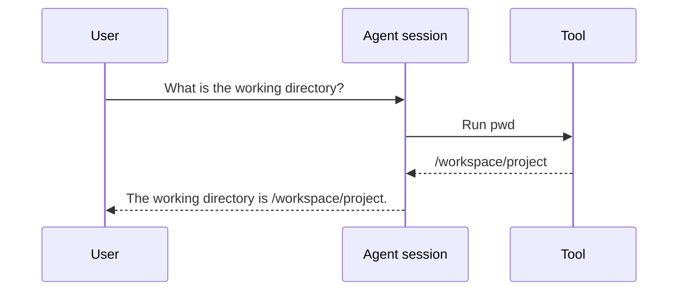

# Normalization walkthrough

This walkthrough tests the [proposed session model](normalized-session-model.md)
against one synthetic interaction in each of the native formats described in
the [session format inventory](session-format-inventory.md). It is a design
exercise, not a claim that these excerpts are complete captures of actual runs.

The task is the same in both examples: the user asks for the working directory,
the agent calls a tool, the tool returns a path, and the agent answers. The
harnesses need not use identical tool names, argument encodings or event
boundaries to perform that interaction.

Examples use synthetic values. Each native code block is one JSON Lines record;
comments make the examples `jsonc`, and omitted fields are not necessarily
absent. Locators in the normalized examples refer to the numbered lines shown
here, not to actual local files. These examples do not establish that the
harnesses emitted every possible record for the interaction.

## 1. The interaction



The model should preserve the user message, tool call, tool result and assistant
message. Their order within each source is known here because they appear in
that order in one artifact. The result links to the call through a native call
identifier. No duration or exit status is assumed from these excerpts.

## 2. Claude native records

The call appears as a `tool_use` block in an assistant entry; the result appears
as a `tool_result` block in a user entry. The result's `tool_use_id` refers to
the call's `id`.

### Line 1: user message

```jsonc
{
  "type": "user",
  "uuid": "c-entry-1",
  "parentUuid": null,
  "sessionId": "c-session-1",
  "message": { "role": "user", "content": "What is the working directory?" }
}
```

### Line 2: tool call

```jsonc
{
  "type": "assistant",
  "uuid": "c-entry-2",
  "parentUuid": "c-entry-1",
  "sessionId": "c-session-1",
  "message": {
    "role": "assistant",
    "content": [{
      "type": "tool_use",
      "id": "c-call-1",              // Native call identifier
      "name": "Bash",
      "input": { "command": "pwd" }
    }]
  }
}
```

### Line 3: tool result

```jsonc
{
  "type": "user",
  "uuid": "c-entry-3",
  "parentUuid": "c-entry-2",
  "sessionId": "c-session-1",
  "message": {
    "role": "user",                  // Entry role; block is a tool result
    "content": [{
      "type": "tool_result",
      "tool_use_id": "c-call-1",      // Refers to line 2
      "content": "/workspace/project",
      "is_error": false
    }]
  }
}
```

### Line 4: assistant message

```jsonc
{
  "type": "assistant",
  "uuid": "c-entry-4",
  "parentUuid": "c-entry-3",
  "sessionId": "c-session-1",
  "message": {
    "role": "assistant",
    "content": [{
      "type": "text",
      "text": "The working directory is /workspace/project."
    }]
  }
}
```

The outer `user` role on line 3 does not turn the tool output into a user
message in the proposed model. Its content block identifies it as a tool
result. The parent links are native evidence too; their precise semantics must
be established before they are treated as universal conversation edges.

## 3. Codex native records

Codex places messages, function calls and outputs in `response_item` payloads.
The call and output carry the same `call_id`. The example does not include
other lifecycle or completed-item records that a real session may also contain.

### Line 1: user message

```jsonc
{
  "type": "response_item",
  "ordinal": 1,
  "payload": {
    "type": "message",
    "role": "user",
    "content": [{ "type": "input_text", "text": "What is the working directory?" }]
  }
}
```

### Line 2: tool call

```jsonc
{
  "type": "response_item",
  "ordinal": 2,
  "payload": {
    "type": "function_call",
    "call_id": "x-call-1",           // Native call identifier
    "name": "example_tool",
    "arguments": "{\\"command\\":\\"pwd\\"}" // Serialized arguments
  }
}
```

### Line 3: tool result

```jsonc
{
  "type": "response_item",
  "ordinal": 3,
  "payload": {
    "type": "function_call_output",
    "call_id": "x-call-1",           // Refers to line 2
    "output": "/workspace/project"
  }
}
```

### Line 4: assistant message

```jsonc
{
  "type": "response_item",
  "ordinal": 4,
  "payload": {
    "type": "message",
    "role": "assistant",
    "content": [{
      "type": "output_text",
      "text": "The working directory is /workspace/project."
    }]
  }
}
```

The source order and `ordinal` agree in this example. The model must preserve
source ordering without assuming that all versions provide an ordinal or that
an ordinal orders records from different sources or sessions.

## 4. Proposed normalized observations

Each native example produces the same sequence of **kinds**, with its own
session, native identifiers, tool name and evidence references. The shapes below
show the Claude mapping; the table after them shows how the Codex mapping
differs. They are separate observations, not one combined cross-harness
execution.

The source `claude-source` identifies the preserved Claude artifact. The
session record associates these observations with `claude-session`; its link to
a wio-eval attempt is supplied by the runner only when known.

```jsonc
{
  "id": "c-obs-1",
  "session_id": "claude-session",
  "kind": "message",
  "order": { "source_id": "claude-source", "position": 1 },
  "data": {
    "role": "user",
    "content": [{ "kind": "text", "text": "What is the working directory?" }]
  },
  "evidence": [{ "source_id": "claude-source", "locator": {
    "kind": "jsonl_line", "line": 1
  }}]
}
```

```jsonc
{
  "id": "c-obs-2",
  "session_id": "claude-session",
  "kind": "tool_call",
  "order": { "source_id": "claude-source", "position": 2 },
  "data": {
    "native_call_id": "c-call-1",
    "name": "Bash",
    "arguments": { "command": "pwd" }
  },
  "evidence": [{ "source_id": "claude-source", "locator": {
    "kind": "jsonl_line", "line": 2
  }}]
}
```

```jsonc
{
  "id": "c-obs-3",
  "session_id": "claude-session",
  "kind": "tool_result",
  "order": { "source_id": "claude-source", "position": 3 },
  "data": {
    "call_observation_id": "c-obs-2", // Supported by matching native IDs
    "native_call_id": "c-call-1",
    "content": "/workspace/project",
    "is_error": false
  },
  "evidence": [{ "source_id": "claude-source", "locator": {
    "kind": "jsonl_line", "line": 3
  }}]
}
```

```jsonc
{
  "id": "c-obs-4",
  "session_id": "claude-session",
  "kind": "message",
  "order": { "source_id": "claude-source", "position": 4 },
  "data": {
    "role": "assistant",
    "content": [{
      "kind": "text",
      "text": "The working directory is /workspace/project."
    }]
  },
  "evidence": [{ "source_id": "claude-source", "locator": {
    "kind": "jsonl_line", "line": 4
  }}]
}
```

| Observation | Claude mapping | Codex mapping |
| --- | --- | --- |
| User message | `user` entry's message content | `response_item` message with user role |
| Tool call | Assistant `tool_use`; native ID `c-call-1` | `function_call`; native ID `x-call-1` |
| Tool result | `tool_result` linked by `tool_use_id`; error flag reported | `function_call_output` linked by `call_id`; no error flag in the excerpt |
| Assistant message | Assistant `text` block | `response_item` message with assistant role |

For Codex, the analogous records use a distinct `codex-session`, `codex-source`
and observation IDs. The adapter can parse the serialized arguments into an
object if parsing succeeds, while retaining the original string through the raw
source. It cannot set `is_error` to `false` merely because the excerpt has no
error flag. It also cannot rename `example_tool` to `Bash` just because the
arguments resemble a shell command.

## 5. What this comparison exposes

1. **Record boundaries differ.** Claude can put multiple blocks in a message,
   so one native entry may produce several observations. A line locator alone
   finds the entry; a block locator could identify the precise evidence more
   clearly. The locator format remains open.
2. **A tool result is not necessarily a user message.** The normalizer uses
   the block's role in the interaction while retaining its native envelope in
   the raw artifact.
3. **Relationships need evidence.** The call IDs support these links. A missing
   call or result should remain unmatched rather than be paired by proximity.
4. **Order is scoped.** The example can order records within each artifact. It
   does not establish a total order across streams, sessions or subagents.
5. **More records do not always mean more activity.** A real Codex stream may
   also expose a completed-item view. Whether it represents the same call must
   be established before merging or counting it; this example does not prove a
   correlation rule.
6. **Missing is not false.** Claude reports an error flag here; the Codex
   excerpt does not. Neither excerpt reports a duration or exit status. The
   normalized records must retain those distinctions.
7. **A common shape does not imply identical behavior.** Different tool names,
   argument formats and harness-specific details remain visible. The model
   describes observations; it does not judge whether the answer is correct.

The next review needs to decide how to encode block-level references, missing
values and normalization diagnostics, then apply the same exercise to usage
and its potentially overlapping scopes.
