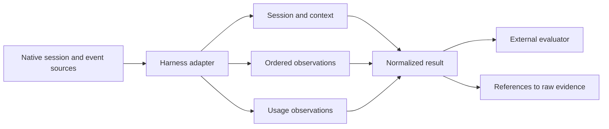
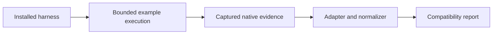

# Proposed normalized session model

This is a proposal for discussion, based on the
[local session format inventory](session-format-inventory.md). It covers session
and event evidence from Claude Code and Codex. Runner lifecycle, workspace
inspection and other harnesses will test and extend it in later steps. It is not
an implemented schema, a file-format specification or a guarantee that either
harness exposes every field shown.

The examples use synthetic values. They are illustrative `jsonc` excerpts:
comments explain fields, omitted fields are not necessarily absent, and the
examples do not prescribe whether records live in one file or many.

## 1. What the model needs to do

An evaluator should be able to follow a session from its context through its
messages, tool activity and usage, then return to the native evidence behind any
normalized observation. The model must support both harnesses without making
one harness's vocabulary the universal shape.



The proposed model has four pieces:

1. **Source:** identifies a preserved native artifact or stream and how it was
   interpreted.
2. **Session:** identifies an agent interaction and links it to the attempt
   that ran it, when that relationship is known.
3. **Observation:** describes one message, tool interaction, lifecycle event or
   other activity, with links to its evidence.
4. **Usage observation:** reports usage at its native scope without assuming
   that it can be added to other reports.

These are logical records. A later design can decide storage layout and how to
index or query them. A workflow stage is included only when an execution driver
can identify it; a turn is a native interaction boundary, not a trial or stage.

## 2. Sources and interpretation

A source identifies the original evidence, its producer and the reader used to
interpret it. A session may draw from more than one source: for example, a
persisted transcript and a structured stdout stream. The example does not say
that a native format version exists when it is not reported.

```jsonc
{
  "id": "source-1",                    // Identity within the result
  "kind": "session_file",             // Source interface, not harness name
  "artifact": "artifact-1",           // Reference to preserved raw evidence
  "harness": "claude-code",
  "producer_version": "example-version", // Reported CLI version, if known
  "native_format_version": null,       // Unknown here; not the CLI version
  "adapter": { "name": "claude-code", "version": "example-version" }
}
```

A source reference can point to a record within an artifact. The locator is
specific to the source representation; this example uses a JSON Lines line
number. If a source has no stable record locator, that limitation must be
reported rather than fabricated.

```jsonc
{
  "source_id": "source-1",
  "locator": { "kind": "jsonl_line", "line": 42 }
}
```

A single normalized observation can cite multiple native records when they
have been reliably correlated. Conversely, one native record can support more
than one normalized observation. The adapter must not merge records just because
their text or timestamps look similar.

## 3. Sessions and context

A session is an agent interaction with its own identity and boundaries where
observable. The runner links it to an attempt only when that relationship is
known. More than one session can belong to an attempt; a resumed session or a
subagent session must not be mistaken for an independent trial.

```jsonc
{
  "id": "session-1",                   // Normalized identity
  "attempt_id": "attempt-1",           // Runner link, when known
  "native_id": "native-session-1",     // Harness identity, if reported
  "parent_session_id": null,            // Known parent, if any
  "sources": ["source-1"],
  "started_at": "2026-01-01T12:00:00Z", // Only if observed
  "ended_at": null,                     // Unknown, not an invented endpoint
  "evidence": [{ "source_id": "source-1", "locator": {
    "kind": "jsonl_line", "line": 1
  }}]
}
```

Context can change during a session, so model, effort, working directory and
permissions should not be treated as a single immutable session header. A
context observation records what was reported at a point in the session and
its scope. It does not assert that unreported settings were absent.

```jsonc
{
  "id": "observation-1",
  "session_id": "session-1",
  "kind": "context",
  "native_turn_id": "turn-1",          // Optional source-provided boundary
  "data": {
    "model": "example-model",
    "effort": "high",
    "working_directory": "/workspace/project"
  },
  "evidence": [{ "source_id": "source-1", "locator": {
    "kind": "jsonl_line", "line": 2
  }}]
}
```

Claude session and entry fields and Codex `session_meta` and `turn_context`
are candidate sources. A native parent or sidechain marker needs interpretation
before it becomes a normalized parent-session link. Conflicting or unknown
relationships stay visible as such.

## 4. Observations and ordering

Observations share an envelope: identity, session, kind, source references and
available order or time. Their `data` differs by kind. The example shows a
message; the next sections show other kinds.

```jsonc
{
  "id": "observation-2",
  "session_id": "session-1",
  "kind": "message",
  "timestamp": "2026-01-01T12:00:01Z", // Source-reported time
  "order": { "source_id": "source-1", "position": 3 },
  "data": {
    "role": "assistant",
    "content": [{ "kind": "text", "text": "I will inspect the project." }]
  },
  "evidence": [{ "source_id": "source-1", "locator": {
    "kind": "jsonl_line", "line": 3
  }}]
}
```

The source's order is evidence; a timestamp alone does not prove a total order
across streams or parallel agents. Native identifiers and explicit relationships
can connect observations, but a missing link remains unknown. Where several
sources overlap, normalization preserves their references and only combines
representations when their identity is supported by evidence.

## 5. Messages and content

A message contains a role and an ordered collection of content parts. Text,
reasoning, attachments and other content can have different availability and
source semantics. A part whose content is unavailable or encrypted must not be
represented as empty text. The model must also distinguish a model-visible
message from runtime output when its source supports that distinction.

```jsonc
{
  "kind": "message",
  "data": {
    "role": "assistant",
    "native_message_id": "message-1",
    "content": [
      { "kind": "text", "text": "I will inspect the project." },
      { "kind": "reasoning", "availability": "unavailable" }
    ]
  }
}
```

Claude `user` and `assistant` message blocks and Codex `response_item` messages
are candidate inputs. Reasoning and completed-item records can be separate
observations or supporting evidence, depending on their established identity.
Unknown content types retain a reference to their native representation rather
than being silently discarded.

### Incremental message content

Some sources emit message fragments rather than complete messages. Preserve
each fragment's source order, exact content and available identity. A complete
message reconstructed from fragments is a derived view only when a verified
source-specific rule establishes the grouping and its completion; an
interrupted stream may leave it partial. The
[Gemini CLI comparison](harness-comparison-gemini.md) illustrates why a message
identifier or boundary cannot always be assumed.

## 6. Tool calls and results

A tool call and result are separate observations linked when a native identifier
or another reliable source establishes the relationship. This allows a call to
remain visible even if its result is missing. Tool-specific details remain
available without requiring every tool to have a command or exit code.

```jsonc
{
  "id": "observation-3",
  "kind": "tool_call",
  "data": {
    "native_call_id": "call-1",
    "name": "example_tool",
    "arguments": { "command": "pwd" }
  }
}
```

```jsonc
{
  "id": "observation-4",
  "kind": "tool_result",
  "data": {
    "call_observation_id": "observation-3", // Only when linked reliably
    "native_call_id": "call-1",
    "content": "/workspace/project",
    "is_error": false
  }
}
```

These excerpts omit the common envelope and evidence references shown above.
For Claude, `tool_use.id` and `tool_result.tool_use_id` are candidate links; for
Codex, call and output records can share `call_id`. A Codex completed item or a
Claude `toolUseResult` may contribute details, but only after its relationship
to the call is established. The original argument or output representation
remains recoverable even if a structured view is available.

Commands and MCP calls are tool activity with additional details when observed:
command, working directory, exit status and duration; or MCP server, tool,
arguments and result. The adapter must not infer server identity solely from a
tool name. Arguments and results may be redacted, and the result must expose
that limitation.

## 7. Usage observations

Usage is a report, not necessarily a count of one independently additive event.
The record preserves the reported scope and source, including whether it is a
per-response report, turn total or session total when known.

```jsonc
{
  "id": "usage-1",
  "session_id": "session-1",
  "scope": { "kind": "turn", "native_id": "turn-1" },
  "report_kind": "total",              // Only if source semantics establish it
  "tokens": {
    "input": 100,
    "output": 20,
    "cached_input": 10
  },
  "evidence": [{ "source_id": "source-1", "locator": {
    "kind": "jsonl_line", "line": 9
  }}]
}
```

Claude message usage and Codex response, turn and thread usage are candidates.
Their categories and scopes must be mapped only after their semantics are
established. A session total and its constituent turn reports may overlap; an
aggregate must choose a defensible basis rather than sum them indiscriminately.
A reported cost or estimate needs its own source, currency and estimation basis
where available. Unknown values are not zero.

## 8. Lifecycle, subagents and other activity

Native lifecycle records can report a turn start, completion or interruption.
The runner independently records process exit and attempt state. A native turn
completion does not alone prove that the trial completed.

```jsonc
{
  "kind": "lifecycle",
  "data": {
    "boundary": "turn",
    "action": "completed",
    "native_id": "turn-1",
    "duration_ms": 1200               // Only when reported
  }
}
```

A subagent relationship can be recorded when the harness exposes it, together
with its native identifiers and evidence. An adapter should preserve an unknown
or incomplete relationship instead of manufacturing a child session. Compaction,
permission decisions, file-related events and other native activity can have
specific observation kinds when their meaning is established. Unrecognized
events stay accessible through raw evidence and a diagnostic describing what
was not normalized.

## 9. Provenance and completeness

Each normalized claim needs traceability to its source. A value can be directly
reported, inferred from evidence or unavailable; these cases must not collapse
into one another. The exact representation of field-level provenance remains an
open design decision. The following illustrates the distinction, not a settled
encoding:

```jsonc
{
  "value": "example-model",
  "status": "observed",              // Or inferred, unavailable or redacted
  "evidence": [{ "source_id": "source-1", "locator": {
    "kind": "jsonl_line", "line": 2
  }}]
}
```

Normalization should report unknown event types, invalid records, truncation,
redaction and unsupported versions where detected. A successful parse is not
proof that the native source contains a complete session. Raw evidence remains
available for a later adapter to reinterpret, subject to the experiment's
redaction and retention policy.

## 10. Decisions to review

Before this becomes a schema contract, the next design steps need to settle:

1. The precise identity and relationship model for turns, sessions, subagents,
   workflow stages and multiple representations of one activity.
2. Whether the common envelope uses field-level provenance, record-level
   provenance with exceptions, or another representation.
3. How content, large outputs and raw evidence are stored and referenced,
   including redaction and unavailable or encrypted content.
4. How to represent usage scopes and overlapping totals without implying that
   token categories mean the same thing across harnesses.
5. How unknown events, version differences, partial sources and normalization
   diagnostics appear to consumers.
6. The runner and workspace records that connect this session model to trials,
   attempts, repository changes and environment provenance.

These questions should be tested against non-interactive streams and additional
harnesses before the model is treated as stable.

## 11. Checking harness compatibility

Harnesses change frequently. A future compatibility check could run a small,
bounded example with an installed harness, capture its native evidence and
pass it through the same adapter and normalizer used for experiments. A working
command name is `wio-eval harness check`; its final interface is open.



The check should identify the harness, its reported version, the tested source
interfaces and the adapter version. It should report which expected observations
were captured and normalized, as well as unknown records, parse errors, missing
expected evidence and any partial or uncertain interpretation. Raw evidence
and diagnostics should be available for inspection, subject to the same
redaction considerations as experiment evidence.

A passing check would show that the tested example and source interfaces worked
under the conditions recorded. It would not certify every event type, tool,
model, execution mode or session format that harness version can produce. A
failed or incomplete check should identify the affected capability and preserve
the evidence needed to investigate; it must not silently claim full support.

The example's scope, expected observations, credential and subscription use,
network requirements, output retention and cleanup need a future design.
Fixtures from known versions remain useful for repeatable regression tests; a
live check complements them by exercising the installed harness and adapter
together. The check reports compatibility, not whether the agent's answer is
correct or its behavior desirable.
