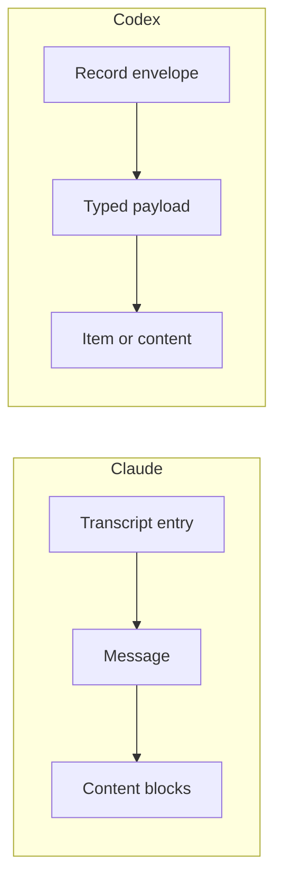
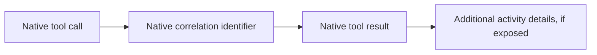

# Session format inventory

This working document identifies evidence shapes found in local Claude Code and
Codex session files. It supports the design of a normalized dataset; it does not
define the schema or claim that all versions and execution modes use these
shapes. The [core concepts](concepts.md) describe the intended role of evidence
in wio-eval.

The inventory covers uncompressed JSON Lines session files under Claude's
`projects` directory and Codex's `sessions` directory. Each line is a JSON
object. It does not cover compressed or archived files, harness stdout or
stderr, all auxiliary files, or provider documentation. Field names below are
examples of observed shapes, not guarantees that every record has those fields.
Values and private conversation content are intentionally omitted.

## 1. How the sources are structured

Claude's transcript entries generally carry their own type, session and entry
identifiers, timestamp and links to a parent entry. User and assistant entries
hold a `message`; its content may contain typed blocks. A tool call and its
result appear as different blocks in different entries.

Codex's records use an outer envelope with a timestamp, type and, where present,
an ordinal. A payload holds a second type and its data. Session metadata, turn
context, response items, lifecycle events and usage records appear as different
record types. Some represent different views of the same activity.

Neither shape alone defines an experiment, trial or attempt. wio-eval must
associate imported session evidence with its own execution records rather than
infer independent trials from native sessions.

## 2. Session and execution context

Claude entries can contain `sessionId`, `uuid`, `parentUuid`, `timestamp`,
`version`, `cwd` and `gitBranch`. Other observed fields include `agentId`,
`isSidechain`, `sessionKind` and permission-related context. Not all entries
carry the same envelope. Claude also has separate metadata entries for things
such as session title, mode and ownership.

Codex has a `session_meta` record with identifiers, timestamp, `cli_version`,
working directory, source, model provider and Git information. `turn_context`
records can describe the model, reasoning effort, working directory, approval
policy and sandbox or permission profile for a turn. Parent thread and agent
fields also occur in metadata. A context record is evidence of reported
configuration; it is not necessarily a complete description of the environment.

For a common model, the open question is how to represent session identity,
parentage, context changes and native source identifiers without assuming that
either harness exposes the same boundaries or hierarchy.

## 3. Messages and conversation

Claude `user` and `assistant` entries contain messages. Message content can be
text or typed blocks, including `text`, `thinking`, `tool_use` and
`tool_result`. Assistant messages can include a model, message identifier,
stop reason and usage. Separate `system` entries include turn duration, local
commands and compaction boundaries among other subtypes. Attachments and
queue operations also appear as entries.

Codex `response_item` payloads include `message`, `reasoning` and
`agent_message` types. Message records can carry role, content, phase and
status; reasoning can contain a summary or encrypted content. Lifecycle records
can also contain completed `UserMessage`, `AgentMessage` and `Reasoning` items.
Compaction has its own records and context information.

A normalized conversation needs to preserve roles, content structure, ordering,
relationships and source references where available. It must not assume that
reasoning or complete message content is readable. It must also avoid counting a
response item and a completed-item representation of the same activity twice;
their exact correlation needs further investigation.

## 4. Tool and MCP activity

Claude assistant messages contain `tool_use` blocks with an identifier, name and
input. User messages can contain `tool_result` blocks that refer to a
`tool_use_id`, carry content and indicate an error. Some user entries also have
`toolUseResult` metadata with fields such as command, output, status, duration
or file details. Available fields depend on the tool.

Codex response items include `function_call`, `custom_tool_call` and their
corresponding output types, linked by `call_id`. Completed lifecycle items can
provide richer typed views, including `CommandExecution`, `FileChange`,
`McpToolCall` and `CollabAgentToolCall`. Their fields can include command,
working directory, exit code, duration, server, tool, arguments, result and
status, depending on the item.

The common model needs calls and results, native identities, available timing
and outcomes, and room for tool-specific details. A missing exit code or
duration must remain missing. Whether a tool name identifies an MCP server and
tool reliably in Claude's records needs separate investigation; it must not be
inferred solely from a naming convention.

## 5. Model usage

Claude assistant message usage can include `input_tokens`, `output_tokens`,
`cache_creation_input_tokens` and `cache_read_input_tokens`, with nested cache
creation and output detail fields in some records. Separate `cost-state` entries
can contain model usage, durations and a reported total cost.

Codex has `token_usage_record` records with usage fields at response, turn and
thread scopes. Observed fields include input, cached input, cache write input,
output, reasoning output and total tokens. `event_msg` token-count records can
also include last and total usage and rate-limit information.

These values cannot be added together blindly: a cumulative total, a turn total
and a response observation can overlap. Cache and reasoning token definitions
may also differ by source. The design must preserve reported scope, semantics
and provenance, distinguish estimates from measured or reported values, and
avoid double counting. The exact meaning of each field requires documentation or
further investigation.

## 6. Lifecycle, errors and interruptions

Claude includes system entries, API-related errors on some assistant entries,
queue operations and turn-duration records. Codex has `task_started`,
`task_complete` and `turn_aborted` events, with turn identifiers and available
timestamps, duration or reason. These are native observations, not a complete
account of the runner's attempt lifecycle.

The runner must separately record process exit, stderr, interruptions, retries
and quota waits that it observes. A native error or rate-limit field is evidence
to interpret, but does not by itself establish a safe retry or quota policy.
The schema must allow incomplete and uncertain outcomes.

## 7. Subagents, files and other evidence

Claude records can include agent identifiers, sidechain markers, tool results
and file-history snapshots or deltas. Codex records can include parent thread
identifiers, `SubAgentActivity`, collaboration tool calls and file-change
items. These provide clues about relationships and file activity, but do not
establish that every subagent or file access is observable.

Neither session format replaces workspace inspection for a trial's starting
state, final diff and recoverable artifacts. Session-derived file or command
activity is reported activity, not proof of every filesystem change. Likewise,
raw session files and other native artifacts need stable references independent
of any normalized view.

## 8. Questions for the schema design

1. Which native identifiers and links can reliably correlate calls, results,
   messages, turns, subagents and multiple representations of the same activity?
2. Which usage records are incremental or cumulative, and how do their token
   categories overlap within and across harnesses?
3. Which fields are available in non-interactive stdout or stderr, and how do
   those streams relate to persisted sessions?
4. How do session formats vary with harness version, configuration, execution
   mode and compaction? How should unknown native events survive normalization?
5. What data can be unavailable, encrypted, truncated or redacted, and how
   should a consumer tell those cases apart?
6. Which evidence belongs to the runner or workspace rather than an adapter,
   and how is it linked to the session without inventing a relationship?

The next step is to propose normalized records and source mappings, then test
them against additional harness documentation and examples. The inventory is
not yet an adapter specification or an exhaustive survey.
