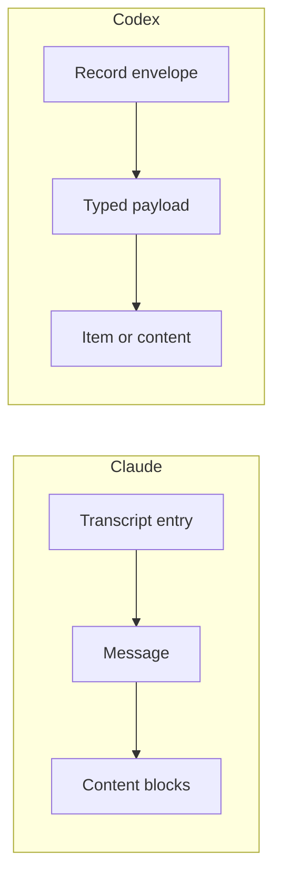

# Session format inventory

This working document identifies evidence shapes found in local Claude Code and
Codex session files. It supports the design of a normalized dataset; it does not
define the schema or claim that all versions and execution modes use these
shapes. The [core concepts](concepts.md) describe the intended role of evidence
in wio-eval.

The inventory covers uncompressed JSON Lines session files under Claude's
`projects` directory and Codex's `sessions` directory. Each line is a JSON
object. It does not cover compressed or archived files, harness stdout or
stderr, all auxiliary files, or provider documentation. Field names below are
examples of observed shapes, not guarantees that every record has those fields.
Examples use synthetic values and omit private conversation content. The
`jsonc` examples are illustrative excerpts: comments explain fields, and omitted
fields are not implied to be absent. They are not literal JSON Lines records or
complete schemas.

## 1. How the sources are structured

Claude's transcript entries generally carry their own type, session and entry
identifiers, timestamp and links to a parent entry. User and assistant entries
hold a `message`; its content may contain typed blocks. A tool call and its
result appear as different blocks in different entries.

Codex's records use an outer envelope with a timestamp, type and, where present,
an ordinal. A payload holds a second type and its data. Session metadata, turn
context, response items, lifecycle events and usage records appear as different
record types. Some represent different views of the same activity.



Neither shape alone defines an experiment, trial or attempt. wio-eval must
associate imported session evidence with its own execution records rather than
infer independent trials from native sessions.

## 2. Session and execution context

A Claude transcript entry can carry session context alongside the message. Not
all entry types use the same envelope:

```jsonc
{
  "type": "user",                    // Kind of transcript entry
  "sessionId": "session-1",          // Native session identifier
  "uuid": "entry-1",                 // Identifier of this entry
  "parentUuid": null,                // Previous or parent entry, if present
  "timestamp": "2026-01-01T12:00:00Z",
  "version": "example-version",      // Reported Claude version
  "cwd": "/workspace/project",       // Working directory
  "gitBranch": "experiment",         // Reported Git branch
  "isSidechain": false,              // Sidechain marker
  "message": { "role": "user", "content": "Describe the project." }
}
```

Codex separates session metadata from turn context. These excerpts represent
two records, each on its own line in a session file:

```jsonc
{
  "timestamp": "2026-01-01T12:00:00Z",
  "ordinal": 1,                      // Sequence field, where present
  "type": "session_meta",
  "payload": {
    "id": "session-1",               // Native session identifier
    "cli_version": "example-version",
    "cwd": "/workspace/project",
    "model_provider": "example-provider",
    "source": "cli"                  // Reported session source
  }
}
```

```jsonc
{
  "type": "turn_context",
  "payload": {
    "turn_id": "turn-1",             // Native turn identifier
    "model": "example-model",
    "effort": "high",                // Reported reasoning effort
    "cwd": "/workspace/project",
    "approval_policy": "on-request"
  }
}
```

Other observed fields include Claude agent and permission context and Codex
parent-thread and sandbox information. Context is evidence of reported
configuration, not necessarily a complete environment description. The common
model must represent identity, parentage and context changes without assuming
that the two harnesses expose the same boundaries.

## 3. Messages and conversation

Claude message content can be a string or a list of typed blocks. An assistant
text entry can have this shape:

```jsonc
{
  "type": "assistant",
  "uuid": "entry-2",
  "parentUuid": "entry-1",
  "message": {
    "id": "message-1",              // Native message identifier
    "role": "assistant",
    "model": "example-model",
    "content": [
      { "type": "text", "text": "The project contains an application." }
    ],
    "stop_reason": "end_turn"        // When reported by the harness
  }
}
```

Other blocks include `thinking`, `tool_use` and `tool_result`. Separate system
entries can describe turn duration, local commands and compaction boundaries;
attachments and queue operations also appear as entries.

Codex puts message data in a typed response payload:

```jsonc
{
  "type": "response_item",
  "payload": {
    "type": "message",              // Response item type
    "id": "message-1",
    "role": "assistant",
    "content": [
      { "type": "output_text", "text": "The project contains an application." }
    ]
  }
}
```

Codex also records `reasoning` and `agent_message` response items. Lifecycle
records can contain completed `UserMessage`, `AgentMessage` and `Reasoning`
items. Compaction has its own records and context information.

A normalized conversation needs roles, content structure, ordering,
relationships and source references where available. It must not assume that
reasoning or complete message content is readable. A response item and a
completed-item representation may describe the same activity; their exact
correlation needs further investigation to avoid double counting.

## 4. Tool and MCP activity

Claude represents a tool call in an assistant entry and its result in a user
entry. The identifiers connect the two blocks:

```jsonc
{
  "type": "assistant",
  "message": {
    "role": "assistant",
    "content": [{
      "type": "tool_use",
      "id": "call-1",                // Identifier of this tool call
      "name": "Bash",                // Native tool name
      "input": { "command": "pwd" }  // Tool-specific arguments
    }]
  }
}
```

```jsonc
{
  "type": "user",
  "message": {
    "role": "user",
    "content": [{
      "type": "tool_result",
      "tool_use_id": "call-1",       // Refers to the tool call
      "content": "/workspace/project",
      "is_error": false
    }]
  }
}
```

Some user entries also have `toolUseResult` metadata with command, output,
status, duration or file details. The available fields depend on the tool.

Codex function calls and outputs use a shared `call_id`:

```jsonc
{
  "type": "response_item",
  "payload": {
    "type": "function_call",
    "call_id": "call-1",             // Links call and output
    "name": "example_tool",
    "arguments": "{\"command\":\"pwd\"}"  // Serialized arguments
  }
}
```

```jsonc
{
  "type": "response_item",
  "payload": {
    "type": "function_call_output",
    "call_id": "call-1",
    "output": "/workspace/project"  // Output shape varies by item type
  }
}
```

Codex also has custom tool calls and completed lifecycle items such as
`CommandExecution`, `FileChange`, `McpToolCall` and `CollabAgentToolCall`.
These can expose command, exit code, duration, server, tool, arguments, result
and status, depending on the item.

The common model needs native identities, available timing and outcomes, and
room for tool-specific details. A missing exit code or duration must remain
missing. Whether Claude tool names reliably identify an MCP server and tool
needs investigation; a naming convention alone is not sufficient evidence.

## 5. Model usage

Claude usage can be attached to an assistant message:

```jsonc
{
  "type": "assistant",
  "message": {
    "usage": {
      "input_tokens": 100,                 // Reported input tokens
      "output_tokens": 20,                 // Reported output tokens
      "cache_creation_input_tokens": 50,   // Cache creation input
      "cache_read_input_tokens": 10        // Cache read input
    }
  }
}
```

Separate `cost-state` entries can contain model usage, durations and a reported
total cost. Some message usage records have nested cache or output details.

Codex can report usage at several scopes in one record:

```jsonc
{
  "type": "token_usage_record",
  "payload": {
    "session_id": "session-1",
    "turn_id": "turn-1",
    "usage": { "input_tokens": 100, "output_tokens": 20 },
    "turn_token_usage": { "input_tokens": 100, "output_tokens": 20 },
    "thread_token_usage": { "input_tokens": 300, "output_tokens": 60 }
  }
}
```

Other observed fields include `cached_input_tokens`, `cache_write_input_tokens`,
`reasoning_output_tokens` and `total_tokens`. Token-count events can also hold
last and total usage and rate-limit information.

These values cannot be added together blindly: a cumulative total, a turn total
and a response observation can overlap. Cache and reasoning token definitions
may also differ by source. The design must preserve reported scope, semantics
and provenance, distinguish estimates from measured or reported values, and
avoid double counting. Exact field meanings require further investigation.

## 6. Lifecycle, errors and interruptions

Claude system entries can report turn duration, among other lifecycle details:

```jsonc
{
  "type": "system",
  "subtype": "turn_duration",
  "sessionId": "session-1",
  "durationMs": 1200                 // Reported duration in milliseconds
}
```

Codex can report a completed turn through an event payload:

```jsonc
{
  "type": "event_msg",
  "payload": {
    "type": "task_complete",
    "turn_id": "turn-1",
    "duration_ms": 1200              // Reported duration in milliseconds
  }
}
```

Claude also has API-related errors and queue operations. Codex has
`task_started` and `turn_aborted` events, with available timestamps or reasons.
These are native observations, not a complete account of the runner's attempt
lifecycle. The runner separately records process exit, stderr, interruptions,
retries and quota waits. A native error or rate-limit field is evidence to
interpret, but does not by itself establish a safe retry or quota policy. The
schema must allow incomplete and uncertain outcomes.

## 7. Subagents, files and other evidence

Codex completed items can identify a subagent and its activity:

```jsonc
{
  "type": "event_msg",
  "payload": {
    "type": "item_completed",
    "turn_id": "turn-1",
    "item": {
      "type": "SubAgentActivity",
      "id": "item-1",
      "agent_thread_id": "agent-1",  // Native agent thread identifier
      "model": "example-model"
    }
  }
}
```

Claude entries can include agent identifiers and sidechain markers, while its
file-history entries contain snapshots or deltas. Codex also has parent-thread
identifiers, collaboration tool calls and file-change items. These provide
clues about relationships and file activity, but do not establish that every
subagent or file access is observable.

Neither session format replaces workspace inspection for a trial's starting
state, final diff and recoverable artifacts. Session-derived file or command
activity is reported activity, not proof of every filesystem change. Raw
session files and other native artifacts need stable references independent of
any normalized view.

## 8. Format evolution and adapter compatibility

Native session formats can change. Claude's documentation explicitly describes
its on-disk transcript format as internal and subject to change between
releases, and recommends its script interfaces for building on session data
([Claude session documentation](https://code.claude.com/docs/en/sessions)).
OpenAI's rollout reconstruction code handles different history modes and older
recorded history, illustrating that Codex persistence also has compatibility
cases
([Codex rollout reconstruction](https://github.com/openai/codex/blob/main/codex-rs/core/src/session/rollout_reconstruction.rs)).
Those observations do not establish a complete history of breaking changes.

The inspected files carry **producer version** information, which is useful
provenance but is not necessarily a schema version:

```jsonc
{
  "type": "assistant",
  "version": "example-cli-version"  // Claude producer version on an entry
}
```

```jsonc
{
  "type": "session_meta",
  "payload": {
    "cli_version": "example-cli-version"  // Codex producer version
  }
}
```

The inspected Claude files contain multiple producer versions, and one file
contains more than one version marker. Codex files also report multiple CLI
versions across sessions. Different observed record types across versions do
not by themselves prove a format change: session activity, configuration and
client mode can differ. No independent schema-version marker was found among
the top-level fields searched in these local JSON Lines records. That limited
search does not prove no such marker exists elsewhere, and a producer version
must not be treated as a documented compatibility promise.

The on-disk files are only one interface. Claude documents `stream-json` and
its Agent SDK as programmatic interfaces
([programmatic use](https://code.claude.com/docs/en/headless),
[SDK types](https://platform.claude.com/docs/en/agent-sdk/typescript)); Codex
has its own non-interactive event interface
([Codex non-interactive mode](https://developers.openai.com/codex/noninteractive/)).
Their schemas, versions and stability must be investigated separately from
persisted sessions. A documented interface is not automatically guaranteed to
have the same content or compatibility policy as the on-disk format.

For a future adapter, the likely approach is one integration per harness with
source-specific readers and compatibility handling for **verified format
changes**, rather than a separate implementation for every CLI release:

1. Record the harness, producer version when known, source interface and the
   normalizer's own version. Keep any reported format version distinct.
2. Select known decoding rules using available version and structural evidence.
   Account for missing, conflicting or mixed producer versions; do not rely on
   the installed CLI version to identify an older file's producer.
3. Preserve raw records and unknown fields or event types. Expose unsupported or
   ambiguous interpretation and partial normalization instead of silently
   dropping evidence or claiming complete support.
4. Test compatibility against sanitized fixtures from supported releases and
   execution modes, including actual breaking changes when identified.

The supported ranges, behavior for unknown versions and how a session spanning
versions is decoded remain design decisions. Separately versioning wio-eval's
normalized result format lets external evaluators identify its contract without
confusing it with either a native format or an adapter implementation version.

## 9. Questions for the schema design

1. Which native identifiers and links can reliably correlate calls, results,
   messages, turns, subagents and multiple representations of the same activity?
2. Which usage records are incremental or cumulative, and how do their token
   categories overlap within and across harnesses?
3. Which fields are available in non-interactive stdout or stderr, and how do
   those streams relate to persisted sessions?
4. How do session formats vary with harness version, configuration, execution
   mode and compaction? How should unknown native events survive normalization?
5. What data can be unavailable, encrypted, truncated or redacted, and how
   should a consumer tell those cases apart?
6. Which evidence belongs to the runner or workspace rather than an adapter,
   and how is it linked to the session without inventing a relationship?

The next step is to propose normalized records and source mappings, then test
them against additional harness documentation and examples. The inventory is
not yet an adapter specification or an exhaustive survey.
